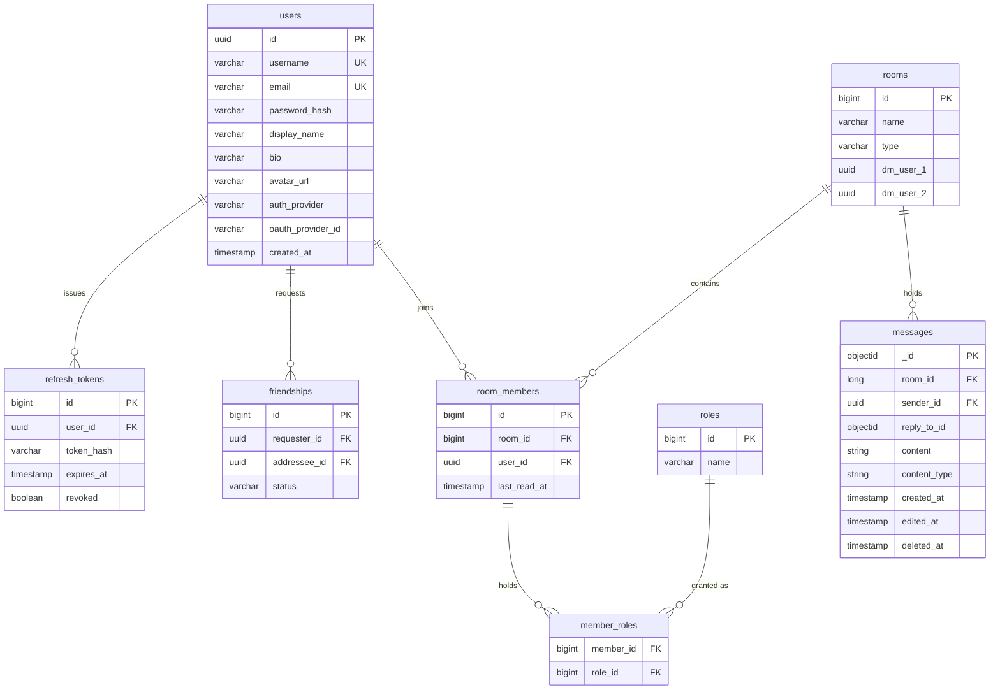

*This project has been created as part of the 42 curriculum by asajed, asoudani, mlakhdar, rahmoham, zdidah.*

# Guild Chat — ft_transcendence

A real-time chat platform built as a distributed web application.

---

## Project layout

Folders follow the service categories in `docker-compose.yml`:

```text
gateway-frontend/
  gateway/
  frontend/
application/
  org-service/
  chat-service/
  identity-service/
  health.sh
databases/
  postgres/
  backup-recovery/
    backup-service/
    scripts/
monitoring/
  prometheus/       # Prometheus and Alertmanager configuration
  grafana/
  status-page/
  scripts/
  metrics-exporters/
    docker-exporter/
deploy/
certs/              # Local certificates
backups/            # Local backup data
```

Services that use upstream images without local files remain configured in Compose.
The root Compose file, Makefile, and `.env` remain the stack entry points.

## Table of Contents

- [Description](#description)
- [Team Information](#team-information)
- [Project Management](#project-management)
- [Technical Stack](#technical-stack)
- [Database Schema](#database-schema)
- [Instructions](#instructions)
- [Features List](#features-list)
- [Modules](#modules)
- [Individual Contributions](#individual-contributions)
- [Resources](#resources)
- [Known Limitations](#known-limitations)

---

## Description

**Guild Chat** is a real-time communication platform in the spirit of Discord or Slack.
Users register or sign in, build a friends list, create group rooms or open
direct messages, and exchange messages that are delivered live over WebSockets to every
connected participant.

Rather than build a game, we chose a domain where the hard problems are the ones we wanted
to learn: concurrent multi-user state, live message fan-out, service-to-service
authorization, and running the whole thing on real infrastructure that we monitor, harden
and back up ourselves.

The application is deployed at **https://guild-chat.tech** and runs locally with a single
`make`.

### Key features

- **Real-time messaging** — messages, edits and presence are pushed over a WebSocket
  connection.
- **Rooms and direct messages** — create group rooms, invite friends, or open a one-to-one
  DM with anyone on your friends list.
- **Friends and presence** — send, accept, decline and cancel friend requests; see who is
  online right now.
- **Profiles and avatars** — editable display name, username and bio, with avatar upload.
- **Role-based permissions** — every room member holds an `OWNER`, `ADMIN` or `MEMBER` role
  that governs who can rename the room, add members, kick members and assign roles.

- **Hardened infrastructure** — an Nginx + ModSecurity WAF in front of everything, full
  Prometheus/Grafana monitoring, a public status page, and automated backups with a tested
  disaster-recovery procedure.

### Architecture

```
                                  Browser
                                     │  HTTPS / WSS
                                     ▼
                    ┌────────────────────────────────┐
                    │   nginx + ModSecurity (WAF)    │   :443
                    │   TLS · rate limiting · OWASP  │
                    └────────────────────────────────┘
                       │        │         │        │
        ┌──────────────┘        │         │        └──────────────┐
        ▼                       ▼         ▼                       ▼
   ┌──────────┐      ┌──────────────┐  ┌──────────────┐   ┌──────────────┐
   │ frontend │      │   identity   │  │     org      │   │     chat     │
   │ React SPA│      │   :8083      │  │    :8082     │   │    :8081     │
   └──────────┘      │ auth · users │  │ rooms · DMs  │   │ messages     │
                     │ friends      │  │ members·roles│   │ WebSocket    │
                     └──────────────┘  └──────────────┘   └──────────────┘
                            │  ▲              │  ▲            │   │
                            │  └──── gRPC ────┘  └─── gRPC ───┘   │
                            │       (ValidateToken, GetUser,      │
                            │        AreFriends, IsMember)        │
                            ▼                  ▼                  ▼
                     ┌─────────────────────────────┐      ┌──────────────┐
                     │ PostgreSQL 16 (2 containers)│      │  MongoDB 7   │
                     │   transdb │ org_service_db  │      │   chatdb     │
                     └─────────────────────────────┘      └──────────────┘

   Observability plane:  prometheus · alertmanager · grafana · gatus · backup-service
```

Services never trust an inbound token on their own. `chat-service` and `org-service` call
`identity-service` over **gRPC** (`ValidateToken`, `GetUser`, `AreFriends`) with a 500 ms
deadline, so authentication has exactly one owner.

---

## Team Information

| Login | Role(s) | Responsibilities |
|---|---|---|
| **asoudani** | Technical Lead / Architect · Developer | Defined the microservice architecture and technology stack. Owns the Nginx + ModSecurity gateway, the Prometheus/Grafana/Gatus observability stack, backups and disaster recovery, the Docker Compose topology, and the GitHub Actions CI/CD pipeline. Reviews critical changes across services. |
| **rahmoham** | Developer | Owns the entire React frontend: routing and session handling, the shared design system, the API client layer (token refresh, error envelopes), and responsive/mobile layout. |
| **mlakhdar** | Project Manager / Scrum Master · Developer | Runs planning, tracks the board and unblocks the team. Owns `chat-service`: the WebSocket handler and handshake authentication, subscription and presence registries, room broadcasting, and message persistence in MongoDB. |
| **zdidah** | Developer | Owns `identity-service`: registration, login, JWT issuance and refresh-token rotation, GitHub OAuth, profiles, avatar storage and the friends system. |
| **asajed** | Product Owner · Developer | Maintains the backlog, prioritises features and validates completed work. Owns `org-service`: rooms, direct messages, membership and the role/permission model. |

---

## Project Management

**How we organised the work.** We split the product along service boundaries so that each
member owned one deployable unit end to end — frontend, identity, org, chat, and
infrastructure. Cross-service contracts (REST shapes and `.proto` definitions) were agreed
in writing before implementation so that two people could work either side of a boundary
without blocking each other. Where the frontend needed an endpoint that did not exist yet,
we shipped the UI anyway behind a feature flag in
[`gateway-frontend/frontend/src/api/features.js`](gateway-frontend/frontend/src/api/features.js), which surfaces a
message naming the missing endpoint instead of silently breaking.

**Tools.**

| Purpose | Tool |
|---|---|
| Code review | GitHub Pull Requests — one branch per feature (`feat/*`), reviewed before merge to `main` |
| CI/CD | GitHub Actions — [`.github/workflows/ci-cd.yml`](.github/workflows/ci-cd.yml) |
| Communication | Discord (daily async updates, voice for pairing) |
| Cross-team docs | [`docs/frontend-backend-gaps.md`](docs/frontend-backend-gaps.md), [`application/identity-service/README.md`](application/identity-service/README.md), [`gateway-frontend/gateway/README.md`](gateway-frontend/gateway/README.md) |

---

## Technical Stack

### Frontend

| Technology | Why |
|---|---|
| React | Component model and ecosystem; the natural fit for a stateful, live-updating SPA. |
| Vite | Near-instant dev server and a fast production build with no config overhead. |
| styled-components | Styles co-located with components and scoped by construction. Chosen over Tailwind because we wanted to author our own design system rather than adopt a vendor's utility vocabulary — see [Modules](#modules). |
| react-router-dom | Client-side routing with the guarded-route pattern used in [`App.jsx`](gateway-frontend/frontend/src/App.jsx). |
| react-icons, @fontsource/inter | Icon set and self-hosted typeface (no external font CDN at runtime). |

Design tokens — colour palette, spacing scale, radii, shadows and semantic aliases — are CSS
custom properties defined once in [`gateway-frontend/frontend/src/index.css`](gateway-frontend/frontend/src/index.css)
and consumed by every component.

### Backend

Identity is migrating to Node.js, TypeScript, Fastify, and Prisma; see its
[runtime contract](application/identity-service/README.md). The Java/Spring stack
below continues to apply to chat and org.

| Technology | Version | Why |
|---|---|---|
| Java | 21 | Long-term-support release; virtual threads and modern language features. |
| Spring Boot | 3.x | A complete backend framework: dependency injection, `spring-security`, `spring-data-jpa`, `spring-data-mongodb`, bean validation and `actuator` health/metrics endpoints out of the box. |
| gRPC + Protocol Buffers | — | Internal service-to-service calls. Strongly typed contracts, generated stubs, and far lower overhead than internal REST hops on the hot path of every authenticated request. |
| Maven | — | Build and dependency management; the wrapper (`./mvnw`) pins the version for CI. |
| Micrometer + Prometheus registry | — | Exposes JVM and HTTP metrics from every service for scraping. |

### Data

| Store | Version | Used for | Why |
|---|---|---|---|
| PostgreSQL | 16 | `transdb` (users, refresh tokens, friendships) and `org_service_db` (rooms, members, roles) | These entities are highly relational with real integrity constraints — unique username/email, a unique friendship pair, a unique `(room, user)` membership. A relational engine enforces that for us. |
| MongoDB | 7 | `chatdb` (messages) | Message history is append-heavy, schema-flexible (replies, edits, soft deletes) and queried almost exclusively as "the last *N* messages in room *X*". A document store with a compound index on `(room_id, created_at)` serves that pattern with no joins. |

Each service owns its own schema and no service reads another's database directly — all
cross-service reads go through gRPC.

### Gateway and infrastructure

| Technology | Role |
|---|---|
| Nginx + ModSecurity v3 + OWASP CRS v4 | TLS termination (TLS 1.2/1.3), reverse proxy, WAF, and rate limiting (20 r/s, burst 30 → HTTP 429) |
| Docker + Docker Compose | 16-service topology on a single private network; only Nginx publishes ports |
| Prometheus + Alertmanager | Metrics collection across 6 scrape jobs, with alert rules routed to Discord |
| Grafana | Dashboards for microservice health and container metrics |
| Gatus | Public status page monitoring 10 endpoints, behind Basic Auth |
| GitHub Actions | CI (lint, build, test, Compose validation) and CD (SSH deploy to the production VM) |

---

## Database Schema

### PostgreSQL — `transdb` (owned by identity-service)

Runs in `identity-service_postgres`, using the existing `database` volume.

| Table | Key fields | Notes |
|---|---|---|
| `users` | `id UUID PK`, `username VARCHAR UNIQUE`, `email VARCHAR UNIQUE`, `password_hash`, `display_name`, `bio VARCHAR(280)`, `avatar_url`, `auth_provider`, `oauth_provider_id`, `created_at`, `updated_at` | `auth_provider ∈ {LOCAL, GITHUB}`. Unique constraint on `(auth_provider, oauth_provider_id)`. Passwords are BCrypt-hashed (salted per record); OAuth users have no `password_hash`. |
| `refresh_tokens` | `id`, `user_id`, `token_hash`, `expires_at`, `revoked`, `created_at` | Indexed on `user_id`. Rotated on every use; presenting an already-used token revokes the whole family (reuse detection). |
| `friendships` | `id`, `requester_id`, `addressee_id`, `status`, `created_at` | `status ∈ {PENDING, ACCEPTED}`. Unique on `(requester_id, addressee_id)`, indexed on both columns. |

### PostgreSQL — `org_service_db` (owned by org-service)

Runs in `org-service_postgres`, using its own `org-service_postgres_data` volume.
Existing installations must [copy organization data](databases/postgres/README.md)
before switching the application to the new container.

| Table | Key fields | Notes |
|---|---|---|
| `rooms` | `id BIGINT PK`, `name VARCHAR(100)`, `type`, `dm_user_1 UUID`, `dm_user_2 UUID`, `created_at`, `updated_at` | `type ∈ {DM, GROUP}`. Unique on `(dm_user_1, dm_user_2)` so a DM between two people can only exist once. |
| `room_members` | `id`, `room_id FK → rooms.id`, `user_id UUID`, `last_read_at` | Unique on `(room_id, user_id)`. `last_read_at` drives unread indicators. |
| `roles` | `id`, `name` | `name ∈ {OWNER, ADMIN, MEMBER}`. |
| `member_roles` | `member_id FK → room_members.id`, `role_id FK → roles.id` | Join table assigning roles to a membership. |



### MongoDB — `chatdb` (owned by chat-service)

Collection **`messages`**: `_id ObjectId`, `room_id Long`, `sender_id UUID`,
`reply_to_id ObjectId?`, `content String`, `content_type String`, `created_at`,
`edited_at?`, `deleted_at?`. A compound index on `(room_id, created_at)` is created
idempotently at startup by `MongoIndexConfig` and backs every history query.

**Cross-store relations.** `messages.room_id → rooms.id` and `messages.sender_id → users.id`
are logical relations, not database foreign keys — they span three services and two engines.
They are enforced in application code: before accepting a message, `chat-service` verifies
the sender's token against `identity-service` and their room membership against
`org-service`, both over gRPC.

---

## Instructions

### Prerequisites

| Requirement | Version | Notes |
|---|---|---|
| Docker Engine | 24+ | Rootless Docker is supported — the Makefile auto-detects the socket. |
| Docker Compose | v2 | Invoked as `docker compose`, not `docker-compose`. |
| GNU Make | any | Entry point for every operation. |
| RAM | ~4 GB free | 15 containers, three of them JVMs. |
| `jq`, `curl` | any | Only for `make status`. |

Node 22 and Java 21 are **not** required to run the project — everything builds inside
containers. They are only needed to develop a service outside Docker.

### Running the project

```bash
git clone <repository-url> ft_transcendence
cd ft_transcendence

cp .env.example .env     # then edit the values — see the table below
make                     # builds and starts the full stack
```

`make` is the single command required by the subject. It resolves the Docker socket, checks
that `.env` exists, and runs `docker compose up -d`.

On the very first start, [`gateway-frontend/gateway/script.sh`](gateway-frontend/gateway/script.sh) generates a self-signed
RSA-2048 certificate into `certs/` if none is present. Your browser will warn about it —
that is expected in local development. In production, real certificates are issued with
Certbot (see [`deploy/README.md`](deploy/README.md)).

Give the stack a minute: Compose gates every service behind a health check, so Nginx only
starts once the databases, the three services and the observability plane report healthy.
Watch progress with `make logs`, and confirm with `make ps`.

### Access

| Surface | URL | Auth |
|---|---|---|
| Application | `https://localhost` | App login |
| Application (HTTP, redirects) | `http://localhost` | — |
| Grafana dashboards | `https://localhost/grafana/` | `GF_SECURITY_ADMIN_USER` / `..._PASSWORD` |
| Status page (Gatus) | `https://status.localhost/` | `STATUS_PAGE_USER` / `..._PASSWORD` |
| Prometheus | `https://localhost/prometheus/` | Restricted to private IP ranges |

### Environment configuration

`.env` is git-ignored; [`.env.example`](.env.example) is the tracked template. Copy it and
change the defaults before any deployment.

| Group | Keys | Notes |
|---|---|---|
| Gateway / WAF | `MODSEC_RULE_ENGINE`, `PARANOIA`, `BLOCKING_PARANOIA` | `DetectionOnly` logs, `On` blocks. Paranoia 1 is standard; 2–4 tighten the OWASP CRS. |
| PostgreSQL | `IDENTITY_POSTGRES_*`, `ORG_POSTGRES_*` | Separate host, port, user, password, and database settings for each service; see [database setup and migration](databases/postgres/README.md). |
| Identity runtime | `IDENTITY_HTTP_PORT`, `IDENTITY_GRPC_PORT`, `AVATAR_DIR`, `DATABASE_URL` | Loaded from `.env`; use internal ports 8083/9090 and avatar storage `/tmp/identity-avatars`. Prisma connects to `identity-service_postgres:5432`. No shared `PORT` is needed. |
| Org datasource | `ORG_DATASOURCE_URL`, `ORG_POSTGRES_USER`, `ORG_POSTGRES_PASSWORD` | Mapped to org's Spring datasource variables by Compose; connects to `org-service_postgres:5432`. |
| JWT | `JWT_SECRET`, `JWT_ISSUER` | **Change `JWT_SECRET`.** The template ships a placeholder; it signs every access token. |
| GitHub OAuth | `GITHUB_CLIENT_ID`, `GITHUB_CLIENT_SECRET`, `GITHUB_REDIRECT_URI` | Create an OAuth app on GitHub and point the callback at `<your-host>/api/users/oauth/github/callback`. Leave blank to disable OAuth; email/password still works. |
| MongoDB | `MONGO_INITDB_ROOT_USERNAME/PASSWORD`, `CHAT_MONGO_DB/USER/PASSWORD/AUTH_DB` | The root pair is applied on first container start only; changing it later requires `docker volume rm mongo_data`. |
| Monitoring | `DS_PROMETHEUS`, `GF_SERVER_ROOT_URL`, `GF_SECURITY_ADMIN_USER/PASSWORD`, `GF_AUTH_*`, `GF_SECURITY_*` | Grafana is served under a subpath, so `GF_SERVER_ROOT_URL` must match your host. |
| Status page | `STATUS_PAGE_USER`, `STATUS_PAGE_PASSWORD`, `STATUS_PAGE_PASSWORD_BCRYPT_BASE64` | The bcrypt hash must correspond to the plaintext password. |

### Make targets

| Target | Effect |
|---|---|
| `make` / `make up` | Start the full stack in the background |
| `make build` | Rebuild images and start |
| `make re` | `clean` then `build` |
| `make down` | Stop and remove containers |
| `make clean` | Stop and remove containers plus orphans |
| `make fclean` | Also remove volumes and prune the Docker system — **destroys all data** |
| `make ps` | Container status table |
| `make logs` | Follow logs from every service |
| `make restart` | Restart all containers |
| `make monitoring` | Rebuild only Grafana, Prometheus, Alertmanager, docker-exporter |
| `make microservices` | Rebuild only the three Spring services |
| `make proxy` | Rebuild only the Nginx gateway |
| `make backup` | Take a snapshot of both databases |
| `make restore SNAPSHOT=<name>` | Restore from a snapshot |
| `make test-recovery` | Run the automated disaster-recovery verification |
| `make status` | Print health for every monitored endpoint |

### Deployment

Production runs on an Oracle Cloud free-tier ARM64 instance. The full procedure — instance
sizing, firewall rules, VM bootstrap and the GitHub Actions secrets
(`OCI_HOST`, `OCI_USERNAME`, `OCI_SSH_KEY`, `OCI_SSH_PORT`) — is documented in
[`deploy/README.md`](deploy/README.md). Merging to `main` triggers an automatic deploy.

---

## Features List

### Authentication and accounts — *zdidah*

| Feature | Description |
|---|---|
| Registration | Email, username and password with validation on both the client and the server. Passwords are BCrypt-hashed and salted. |
| Login / logout | Issues a short-lived access token (15 min) and a refresh token (7 days). |
| Silent token refresh | The frontend refreshes the access token before expiry, so sessions survive page reloads without a re-login. |
| Refresh-token rotation | Every refresh issues a new token and invalidates the old one. Presenting a consumed token revokes every session for that user. |
| GitHub OAuth 2.0 | Sign in with a GitHub account; the local and OAuth identities are distinct `auth_provider` records. |

### Profiles and friends — *zdidah*

| Feature | Description |
|---|---|
| Profile view and edit | Display name, username and bio, with live username-availability checking. |
| Avatar upload | Multipart upload capped at 5 MB, stored on a dedicated Docker volume and served back through the gateway. |
| Friend requests | Send by username, with accept, decline and cancel flows for incoming and sent requests. |
| Friends list | List and remove friends. |
| Online presence | Live online/offline indicator driven by the chat-service presence registry. |

### Rooms, DMs and permissions — *asajed*

| Feature | Description |
|---|---|
| Group rooms | Create, list, rename and delete rooms. |
| Direct messages | Open a one-to-one conversation with a friend; the unique-pair constraint guarantees a single DM per pair. |
| Membership | Owners and admins add friends to a room directly and kick members; any member can leave. |
| Roles | `OWNER`, `ADMIN` and `MEMBER`, with role assignment restricted to owners and admins. `OWNER` cannot be reassigned. |
| Read markers | `last_read_at` per membership, driving unread state in the sidebar. |

### Messaging — *mlakhdar*

| Feature | Description |
|---|---|
| Send and receive | Messages persist to MongoDB and broadcast over WebSocket to every subscriber of the room. |
| Live delivery | A single `/ws/chat` socket per client, authenticated at handshake, multiplexed across rooms via `subscribe` / `unsubscribe` frames. |
| Replies | Reply to a message; the reply renders a quoted line that jumps to the original when clicked. |
| Editing | Edit your own messages within a 15-minute window; the edit broadcasts as a `message.edited` frame. |
| History | Paginated room history served from the compound `(room_id, created_at)` index. |
| Presence | Per-room presence tracking with graceful handling of disconnects. |

### Interface — *rahmoham*

| Feature | Description |
|---|---|
| Design system | 11 reusable components with a shared token layer — see [Modules](#modules). |
| Responsive layout | Adapts from desktop three-pane to a mobile single-pane layout with slide-over panels. |
| Graceful degradation | UI depending on an unshipped endpoint stays visible and explains what is missing, rather than breaking. |
| Privacy Policy | Accessible at `/privacy`, linked from the footer on every page. Describes what personal data we collect (account details, avatars, message content, presence), why, how long we keep it, and how to request deletion. |
| Terms of Service | Accessible at `/terms`, linked from the footer on every page. Covers acceptable use, account responsibilities, content ownership and termination. |

### Operations — *asoudani*

| Feature | Description |
|---|---|
| WAF | ModSecurity v3 with OWASP CRS v4 in blocking mode, tuned per route. |
| Rate limiting | 20 requests/second per IP with a burst of 30 on all API routes; excess returns HTTP 429. |
| HTTPS everywhere | TLS 1.2/1.3 termination at the gateway; HTTP redirects to HTTPS. |
| Metrics | Six Prometheus scrape jobs covering the three services, the gateway, the container exporter and Prometheus itself. |
| Dashboards | Grafana dashboards for microservice health and container resource usage. |
| Alerting | Rules for service/container downtime, OOM kills, high CPU and memory, and elevated 5xx rates, routed to Discord via Alertmanager. |
| Status page | Gatus monitoring 10 endpoints, published behind Basic Auth. |
| Backups | A backup daemon snapshots both databases on a schedule, with restore and an automated recovery test. |
| CI/CD | Lint, build, three-service test matrix and Compose validation on every PR; automatic deploy on merge to `main`. |

---

## Modules

**Total claimed: 21 points.**

| # | Category | Module | Type | Points | Owner |
|---|---|---|---|---:|---|
| 1 | Web | Framework for frontend **and** backend | Major | 2 | rahmoham, zdidah, mlakhdar, asajed |
| 2 | Web | Real-time features (WebSockets) | Major | 2 | mlakhdar |
| 3 | Web | User interaction (chat, profiles, friends) | Major | 2 | rahmoham, zdidah, mlakhdar |
| 4 | Web | ORM for the database | Minor | 1 | zdidah, asajed |
| 5 | Web | Custom design system | Minor | 1 | rahmoham |
| 6 | Accessibility & i18n | Support for additional browsers | Minor | 1 | rahmoham |
| 7 | User Management | Standard user management and authentication | Major | 2 | zdidah |
| 8 | User Management | Advanced permissions system | Major | 2 | asajed |
| 9 | Modules of choice | Hardened ModSecurity WAF | Minor | 1 | asoudani |
| 10 | DevOps | Monitoring with Prometheus and Grafana | Major | 2 | asoudani |
| 11 | DevOps | Backend as microservices | Major | 2 | asoudani |
| 12 | DevOps | Health checks, status page, automated backups and disaster recovery | Minor | 1 | asoudani |
| | | | | **19** | |

### 1 · Framework for both frontend and backend — Major (2 pts)

*Why:* a project split across four deployable units needs conventions, not glue code.

*How:* the frontend is a **React 19** application built with Vite, using `react-router-dom`
for routing and the guarded-route pattern in
[`gateway-frontend/frontend/src/App.jsx`](gateway-frontend/frontend/src/App.jsx). All three backend services are
**Spring Boot** applications using `spring-boot-starter-web`, `-data-jpa` or
`-data-mongodb`, `-security`, `-validation` and `-actuator`.

### 2 · Real-time features (WebSockets) — Major (2 pts)

*Why:* a chat application is only convincing if messages arrive without a refresh.

*How:* `chat-service` exposes a native WebSocket endpoint at `/ws/chat`. The token is
validated during the handshake by `TokenHandshakeInterceptor` — an unauthenticated socket is
never established. `SubscriptionRegistry` maps sessions to rooms so `RoomBroadcaster` fans a
message out only to the sessions that need it, rather than to every connected client.
`PresenceRegistry` tracks who is online and cleans up on disconnect. The protocol
(`WsEvents`) carries `subscribe`, `unsubscribe`, `message.new`, `message.edited`,
`message.deleted` and `error` frames. On the client, `useRoomMessages` and `usePresence`
own the socket lifecycle and reconnection.

*Multi-user support:* concurrent writes are safe by construction — message identity comes
from MongoDB, and membership uniqueness is enforced by a database constraint rather than a
read-then-write check.

### 3 · User interaction (chat, profiles, friends) — Major (2 pts)

*Why:* the module's three requirements are the core of the product.

*How:* **Chat** — rooms and DMs with persisted history, replies and edits.
**Profiles** — viewable user profiles with display name, bio and avatar, openable from any
member list or message. **Friends** — a full request lifecycle (send, accept, decline,
cancel, remove) backed by the `friendships` table, with live online status.

### 4 · ORM for the database — Minor (1 pt)

*Why:* hand-written SQL across two relational schemas and three services would be the
largest source of drift in the project.

*How:* **Spring Data JPA / Hibernate** in `identity-service` and `org-service`. Entities
under `application/*/src/main/java/**/model/` are the single source of truth for the schema;
repositories are derived interfaces. `spring-data-mongodb` plays the equivalent role in
`chat-service`.

### 5 · Custom design system — Minor (1 pt)

*Why:* we deliberately did not adopt a component library, so that the interface would be
ours and internally consistent.

*How:* a token layer in [`gateway-frontend/frontend/src/index.css`](gateway-frontend/frontend/src/index.css) defines
the colour palette (dark theme with a crimson accent), typography scale (Inter, self-hosted),
spacing, radii, shadows and semantic aliases. Built on it are **11 reusable components** in
[`gateway-frontend/frontend/src/components/ui/`](gateway-frontend/frontend/src/components/ui/) — exceeding the
10-component minimum:

`Avatar` · `Button` · `Card` · `ConfirmDialog` · `Feedback` · `IconButton` · `Input` ·
`Skeleton` · `SlidePanel` · `StatusDot` · `Tabs`

Icons come from `react-icons`. Every feature component composes these rather than
redefining its own buttons or avatars — `ConfirmDialog` in particular replaced the last
native `window.confirm` / `window.alert` calls in the codebase.

### 6 · Support for additional browsers — Minor (1 pt)

*Why:* the mandatory target is Chrome, but a chat client people actually use has to work
wherever they already are.

*How:* the application is tested and functional in **Mozilla Firefox** and **Microsoft
Edge** in addition to Chrome. The build targets baseline-widely-available features through
Vite's default browser targets; no vendor-prefixed or Chrome-only APIs are used. The
WebSocket client, `fetch`-based API layer and CSS custom-property token system are all
standard across the three engines, giving a consistent UI and identical feature set.

### 7 · Standard user management and authentication — Major (2 pts)

*Why:* the mandatory user system, taken to the module's bar.

*How:* users update their profile information (display name, username, bio); upload an
avatar, with a generated default when none is set; add other users as friends and see their
online status; and have a profile page that any other user can open. Authentication uses
BCrypt-hashed passwords, HS256 JWTs and rotating refresh tokens with reuse detection.

### 8 · Advanced permissions system — Major (2 pts)

*Why:* a shared room needs an answer to "who is allowed to do this", and that answer has to
be enforced on the server.

*How:* `org-service` models `OWNER`, `ADMIN` and `MEMBER` roles through the
`roles` / `member_roles` tables. Full CRUD over rooms and memberships is exposed at
`/rooms` — create, read, update, delete rooms; add, remove and list members; read and assign
roles. Each action is authorised against the caller's role in that specific room, so the
permission check is per-resource rather than global. Different roles get different views and
actions: only owners and admins see the add-member and kick controls, only owners can delete
or rename a room, and `OWNER` cannot be assigned to another member.

### 9 · Hardened ModSecurity WAF — Minor, Module of choice (1 pt)

*Why:* everything in this project is exposed to the public internet on a real domain. We
wanted a defensive layer that inspects requests rather than trusting the application tier to
be flawless. We claim it as a Module of choice because our implementation covers the WAF
half of the Cybersecurity module thoroughly, without the HashiCorp Vault component — see
[Known Limitations](#known-limitations).

*How:* [`gateway-frontend/gateway/`](gateway-frontend/gateway/) builds on `owasp/modsecurity-crs:nginx`, running **ModSecurity
v3 with OWASP Core Rule Set v4** in blocking mode. Configuration:

- Tunable paranoia levels (`PARANOIA`, `BLOCKING_PARANOIA`) and engine mode
  (`On` / `DetectionOnly`) via environment variables.
- An explicit allowed-method list.
- Per-route rule-engine control — inspection is disabled for the WebSocket upgrade path and
  for the Grafana, Prometheus and status-page proxies, where CRS produces false positives on
  legitimate traffic.
- Rate limiting at 20 r/s per IP with a burst of 30, returning HTTP 429.
- IP allowlisting (loopback and RFC1918 ranges only) on `/nginx_status`, `/prometheus/` and
  `/metrics.prom`.
- TLS 1.2/1.3 termination with an HTTP→HTTPS redirect.

Full routing table and policy detail: [`gateway-frontend/gateway/README.md`](gateway-frontend/gateway/README.md).

### 10 · Monitoring with Prometheus and Grafana — Major (2 pts)

*Why:* with 15 containers, "is it up?" stops being answerable by looking.

*How:* **Prometheus** scrapes six jobs — the three Spring services via Micrometer actuator
endpoints, the Nginx gateway via `nginx-exporter`, a custom container exporter, and itself.
The **docker-exporter** is a bash service we wrote that publishes per-container metrics on
port 8090. **Grafana** serves two dashboards (`microservices-dashboard.json`,
`docker-metrics.json`) under an authenticated subpath with anonymous access disabled.
**Alertmanager** routes rules — `MicroserviceDown`, `ContainerDown`, `ContainerOOMKilled`,
`HighContainerCpuUsage`, `HighContainerMemoryUsage`, `HighHttp5xxErrorRate` — to Discord.
Details: [`monitoring/README.md`](monitoring/README.md).

### 11 · Backend as microservices — Major (2 pts)

*Why:* three people owning three services could work in parallel with far less contention
than three people in one codebase — and it forced us to make contracts explicit.

*How:* the backend is three loosely coupled Spring Boot services, each with a single
responsibility and its own datastore:

| Service | Responsibility | Port | Store |
|---|---|---|---|
| `identity-service` | Authentication, users, profiles, avatars, friendships | 8083 (HTTP), 9090 (gRPC) | PostgreSQL `transdb` |
| `org-service` | Rooms, DMs, membership, roles | 8082 (HTTP), gRPC | PostgreSQL `org_service_db` |
| `chat-service` | Messages, WebSocket delivery, presence | 8081 (HTTP + WS) | MongoDB `chatdb` |

Communication is by **gRPC** with Protocol Buffers contracts
(`application/*/src/main/proto/*.proto`) and a 500 ms deadline on every call.
`identity-service` exposes `ValidateToken`, `GetUser` and `AreFriends`; `org-service`
exposes membership lookups to `chat-service`. No service reaches into another's database.
Authentication has exactly one owner: `chat-service` performs no local JWT parsing and
delegates every token check to `identity-service`.

### 12 · Health checks, status page, automated backups and disaster recovery — Minor (1 pt)

*Why:* a deployment you cannot restore is a deployment you do not really have.

*How:*

- **Health checks** on every Compose service, with `depends_on: condition: service_healthy`
  gating startup order so the gateway never fronts a service that is not ready.
- **Status page** — a Gatus instance monitoring 10 endpoints, published at `https://status.${DOMAIN}/` behind
  Basic Auth.
- **Automated backups** — a `backup-service` container snapshots PostgreSQL and MongoDB on a
  schedule ([`databases/backup-recovery/backup-service/`](databases/backup-recovery/backup-service/)).
- **Disaster recovery** — [`databases/backup-recovery/scripts/restore.sh`](databases/backup-recovery/scripts/) restores from a snapshot, and
  `databases/backup-recovery/scripts/test-disaster-recovery.sh` runs an automated five-step verification that the
  procedure actually works. Documented in [`databases/backup-recovery/scripts/README.md`](databases/backup-recovery/scripts/README.md).

### Bonus candidate (not counted in the 19)

**Organization system — Major (2 pts).** `org-service` implements create, read, update and
delete for rooms; adding and removing users; and scoped per-room actions gated by role. If
rooms are accepted as organizations, this module applies and the total becomes 21.

---

## Individual Contributions

### asoudani — Technical Lead / Architect · Developer

Chose the microservice split and the gRPC-between-services model, and built every layer
below the application: the [`gateway-frontend/gateway/`](gateway-frontend/gateway/) Nginx + ModSecurity image, the 16-service
[`docker-compose.yml`](docker-compose.yml) topology with health-gated startup, the
[`Makefile`](Makefile), the full [`monitoring/`](monitoring/) observability stack (Prometheus,
Alertmanager, Grafana dashboards, Gatus, a hand-written bash container exporter), the backup
and disaster-recovery [`databases/backup-recovery/scripts/`](databases/backup-recovery/scripts/), and the
[CI/CD pipeline](.github/workflows/ci-cd.yml) with its OCI deployment.

*Challenges.* Tuning ModSecurity was the hardest part: CRS v4 at default paranoia flagged
legitimate chat payloads and broke the WebSocket upgrade outright. The fix was per-location
rule-engine control rather than blanket rule exclusions, keeping full inspection on the API
surface while exempting the upgrade path and the proxied admin UIs. Getting Grafana to serve
correctly under a subpath behind the WAF required aligning `GF_SERVER_ROOT_URL` with the
proxy configuration. Running Docker rootless on some machines and rootful on others also
meant the Makefile had to detect the socket path rather than assume it.

### rahmoham — Frontend Developer

Built the entire React application: routing and session restoration in
[`App.jsx`](gateway-frontend/frontend/src/App.jsx), the API client layer
([`src/api/`](gateway-frontend/frontend/src/api/)) with bearer-token handling, silent refresh and
per-service error envelopes, the design-system layer, and every feature surface — landing,
auth, app shell, rooms, DMs, profiles and member lists — plus the responsive/mobile layout
and the Privacy Policy and Terms of Service pages.

*Challenges.* The frontend consistently ran ahead of the backend, which meant either
blocking or building against endpoints that did not exist. The solution was the feature-flag
layer in [`features.js`](gateway-frontend/frontend/src/api/features.js): unfinished UI stays visible and
reports the specific endpoint it needs, so integration became a one-line change per endpoint
as each landed. Silent token refresh was the other difficult piece — concurrent requests
hitting an expired token must trigger exactly one refresh and then replay, not a stampede.
`org-service` also originally returned only member IDs, forcing an N+1 lookup per DM to
resolve the other participant; that was resolved by having the service return the peer
directly on the room response.

### mlakhdar — Project Manager / Scrum Master · Developer, chat-service

Ran planning, kept the board current and unblocked the team. Owns `chat-service`: the
WebSocket handler and `TokenHandshakeInterceptor`, `SubscriptionRegistry`,
`PresenceRegistry`, `RoomBroadcaster` and `FrameSender`, the REST message API, MongoDB
persistence with the compound history index, and the gRPC clients to identity and org. Wrote
the deepest test suite in the project — roughly 20 test classes including WebSocket handshake
and broadcast coverage.

*Challenges.* Authenticating a WebSocket is not the same problem as authenticating a request:
browsers cannot set headers on the upgrade, and the connection is long-lived, so the check
has to happen once at handshake and the identity must then be pinned to the session.
Broadcasting also had to stay selective — an early version pushed every message to every
connected session, which the subscription registry replaced. The 500 ms gRPC deadline was
chosen so that a slow dependency degrades into a clear error rather than a hung socket.

### zdidah — Developer, identity-service

Owns `identity-service`: registration and login, JWT issuance and validation (`JwtService`,
`JwtAuthenticationFilter`), refresh-token rotation, GitHub OAuth (`GithubOAuthService`),
profile management, avatar storage (`AvatarStorageService`), the friends system
(`FriendService`), and the gRPC server that the other two services depend on.

*Challenges.* Refresh-token rotation is easy to get subtly wrong. The design settled on
revoking an entire token family when a consumed token is replayed, which turns a stolen
token into a detectable event rather than a silent compromise. Serving the gRPC endpoint
alongside the HTTP API also required `GrpcSecurityConfig` to keep gRPC traffic outside the
Spring Security filter chain — otherwise the servlet filters rejected internal calls that
carry no user token of their own.

### asajed — Product Owner · Developer, org-service

Maintained the backlog and validated completed work, and owns `org-service`: the room and DM
model, membership, the role system, the full `/rooms` REST surface, the gRPC client to
identity, and the gRPC server that answers membership questions from `chat-service`.

*Challenges.* Preventing duplicate DMs between the same two people is a race condition if
checked in application code, so it is enforced with a unique constraint on the normalised
`(dm_user_1, dm_user_2)` pair and the conflict handled on insert. Designing the role check to
be per-room rather than global also meant authorisation could not live in a Spring Security
rule — it had to be resolved per request against the caller's membership in that specific
room.

---

## Resources

### Documentation and references

- [Spring Boot Reference Documentation](https://docs.spring.io/spring-boot/docs/current/reference/html/)
- [Spring Security Architecture](https://docs.spring.io/spring-security/reference/servlet/architecture.html)
- [Spring Data JPA](https://docs.spring.io/spring-data/jpa/reference/) · [Spring Data MongoDB](https://docs.spring.io/spring-data/mongodb/reference/)
- [gRPC Java documentation](https://grpc.io/docs/languages/java/) and the [Protocol Buffers language guide](https://protobuf.dev/programming-guides/proto3/)
- [React documentation](https://react.dev/) · [Vite guide](https://vite.dev/guide/) · [React Router](https://reactrouter.com/)
- [styled-components documentation](https://styled-components.com/docs)
- [MDN — The WebSocket API](https://developer.mozilla.org/en-US/docs/Web/API/WebSockets_API)
- [OWASP Core Rule Set](https://coreruleset.org/docs/) and the [ModSecurity v3 reference](https://github.com/owasp-modsecurity/ModSecurity/wiki)
- [OWASP Cheat Sheet Series](https://cheatsheetseries.owasp.org/) — authentication, password storage, session management
- [Prometheus documentation](https://prometheus.io/docs/) · [Grafana documentation](https://grafana.com/docs/) · [Gatus](https://github.com/TwiN/gatus)
- [MongoDB indexing strategies](https://www.mongodb.com/docs/manual/applications/indexes/)
- [Nginx reverse proxy and WebSocket proxying guides](https://nginx.org/en/docs/)
- RFC 6749 — *The OAuth 2.0 Authorization Framework*; RFC 7519 — *JSON Web Token*; RFC 6455 — *The WebSocket Protocol*
- [Docker Compose specification](https://docs.docker.com/compose/compose-file/)

### How AI was used

We used AI assistants (ChatGPT, Claude) as a productivity tool, on the terms the subject
sets out: nothing was merged that its author could not explain and defend.

**Where it helped:**

- *Boilerplate and scaffolding* — initial Spring Boot service skeletons, DTO and mapper
  classes, repository interfaces, and React component shells. Mechanical code we would
  otherwise have typed by hand.
- *Infrastructure configuration* — first drafts of Dockerfiles, Compose service definitions,
  Prometheus scrape configs, Grafana dashboard JSON and Alertmanager routing. Generated
  configuration was consistently the least reliable output and needed the most correction,
  particularly around the ModSecurity and Grafana subpath setup.
- *Debugging* — as a rubber duck for stack traces and misbehaving configuration, especially
  the WebSocket upgrade failing behind the WAF and gRPC calls being rejected by Spring
  Security filters. AI suggested directions; the diagnoses were ours.
- *Documentation* — drafting and structuring this README and the per-component docs from
  notes and from the code itself.
- *Learning* — explaining unfamiliar territory (gRPC in Spring, the OWASP CRS rule model,
  Micrometer's registry) faster than reading reference documentation cold.

**Where we did not use it:** the architecture itself — the service split, the gRPC contracts,
the data model, and the decision to centralise token validation in one service — was designed
by the team. We also wrote the security-sensitive logic by hand and reviewed it together:
token rotation and reuse detection, the per-room authorisation checks, and the WebSocket
handshake authentication.

**Our process:** generated code was read line by line, adapted to the conventions of the
codebase, tested, and reviewed by a second team member in a pull request before merge. Where
an AI suggestion conflicted with something we had verified ourselves, we went with the
verified answer — this happened often enough with configuration to be a working assumption.

---

## Known Limitations

We would rather state these than have them found:

- **HashiCorp Vault is not deployed.** Secrets are managed through a git-ignored `.env` file
  and GitHub Actions secrets. This is why the WAF work is claimed as a Module of choice
  rather than as the full Cybersecurity module.
- **No internationalisation.** The interface is English only.
- **No two-factor authentication.** Account security rests on password hashing, short-lived
  access tokens and refresh-token reuse detection.
- **Single-instance deployment.** Production runs on one VM with no horizontal scaling or
  failover. Backups and a tested restore procedure are the recovery story.
- **Schema management is `ddl-auto: update`.** There is no Flyway or Liquibase migration
  history, which is acceptable for the project's scope but would not be for a
  long-lived production system.
