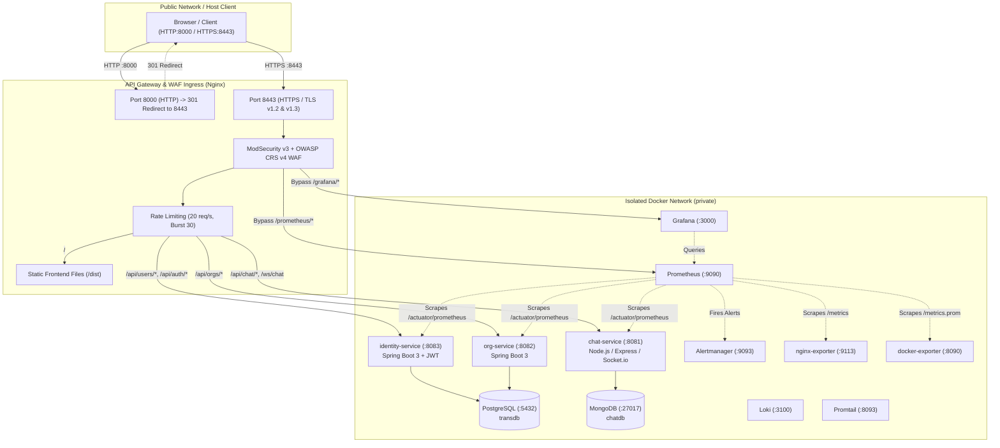

# Infrastructure Architecture & System Hardening Documentation

**Role:** Infrastructure Architect & System Hardening  
**Project:** `ft_transcendence`  
**Evaluation Scope:** 6 Points Contributed  
- **Backend as Microservices (Major — 2 pts)**
- **Monitoring System (Major — 2 pts)**
- **Cybersecurity Hardening (Major — 2 pts)**

---

## 1. System Overview & Architecture

The infrastructure of `ft_transcendence` is designed around defense-in-depth principles, zero-trust container isolation, unified ingress management, end-to-end monitoring, and automated threat mitigation.



---

## 2. Module 1: Backend as Microservices (2 pts)

### 2.1 Architectural Ingress & Host Port Isolation
- **Host Port Shielding:** All backend microservices (`identity-service`, `org-service`, `chat-service`) and databases (`postgres`, `mongodb`) are unmapped from the host network. They communicate strictly over an internal Docker bridge network (`private`).
  - `http://localhost:8082` $\rightarrow$ Connection Refused.
  - `http://localhost:8083` $\rightarrow$ Connection Refused.
  - `http://localhost:5432` $\rightarrow$ Connection Refused.
- **Single Ingress Pattern:** The Nginx API Gateway is the **only entry point** exposed to the host machine on ports `8000:80` and `8443:443`.
- **Startup Order Synchronization:** Configured `condition: service_healthy` in [`docker-compose.yml`](file:///home/seraph/dev/ft_transcendence/docker-compose.yml) under `nginx.depends_on` to ensure upstream services complete healthchecks before Nginx starts forwarding traffic, eliminating 502 Bad Gateway race conditions.

### 2.2 TLS / SSL Termination & HTTP-to-HTTPS Redirection
- **Automatic TLS Redirection:** Requests to `http://localhost:8000/` receive an automated `301 Moved Permanently` redirect to `https://localhost:8443/`.
- **Modern TLS Ciphers & Protocols:**
  ```nginx
  ssl_protocols TLSv1.2 TLSv1.3;
  ssl_ciphers HIGH:!aNULL:!MD5;
  ```
- **SAN SSL Certificates:** Self-signed certificates generated dynamically by [`gateway/script.sh`](file:///home/seraph/dev/ft_transcendence/gateway/script.sh) include Subject Alternative Names (SAN) for both `DNS:localhost` and `IP:127.0.0.1` to eliminate modern browser certificate rejections.

### 2.3 Upstream Routing & Traffic Management
Configured in [`gateway/nginx.conf`](file:///home/seraph/dev/ft_transcendence/gateway/nginx.conf):
- **Rate Limiting:** Protects backend APIs against brute-force and denial-of-service attempts:
  ```nginx
  limit_req_zone $binary_remote_addr zone=api_limit:10m rate=20r/s;
  limit_req_status 429;
  ```
- **API Routing Matrix:**
  - `/api/users/` $\rightarrow$ `http://identity-service:8083/`
  - `/api/auth/` $\rightarrow$ `http://identity-service:8083/`
  - `/api/orgs/` $\rightarrow$ `http://org-service:8082/`
  - `/api/rooms/` $\rightarrow$ `http://chat-service:8081/api/rooms/`
  - `/api/chat/` $\rightarrow$ `http://chat-service:8081/`
  - `/ws/chat` $\rightarrow$ `http://chat-service:8081` with WebSocket protocol upgrades (`Upgrade: $http_upgrade`, `Connection: "upgrade"`, timeout: `3600s`).

---

## 3. Module 2: Monitoring & Observability System (2 pts)

### 3.1 Prometheus Metrics Pipeline
Prometheus (`prom/prometheus`) collects operational time-series metrics from across the infrastructure. All 7 target endpoints report `health: "up"`:

| Job Name | Target Instance | Scrape Endpoint | Metrics Exposed |
|---|---|---|---|
| `identity-service` | `identity-service:8083` | `/actuator/prometheus` | JVM memory, GC, HTTP request latency & status codes |
| `org-service` | `org-service:8082` | `/actuator/prometheus` | Spring Boot Actuator JVM and application metrics |
| `chat-service` | `chat-service:8081` | `/actuator/prometheus` | Node.js process CPU, event loop lag, HTTP throughput |
| `nginx-gateway` | `nginx-exporter:9113` | `/metrics` | Active connections, request rates, status codes |
| `docker-exporter` | `docker-exporter:8090` | `/metrics.prom` | Container CPU, memory limits, network I/O, OOM status |
| `prometheus` | `prometheus:9090` | `/metrics` | Prometheus ingestion rate, storage chunk performance |
| `promtail` | `promtail:8093` | `/metrics` | Log ingestion volume, file collection offsets |

#### Microservice Instrumentation Fixes:
1. **`org-service` Actuator Integration:** Added `spring-boot-starter-actuator` to `services/org-service/pom.xml` and exposed `health,info,prometheus` endpoints in `application.yaml`.
2. **Spring Security Actuator Whitelisting:** Configured Spring Security in both `identity-service` and `org-service` (`SecurityConfig.java` and `JwtAuthenticationFilter.java`) to permit `/actuator/**` without JWT authentication, allowing Prometheus internal scrapes while protecting business endpoints.
3. **`chat-service` Prometheus Support:** Configured the metrics middleware to export Prometheus-compliant metrics on `/actuator/prometheus`.

### 3.2 Grafana Dashboards Provisioning
- **Automatic Provisioning:** Configured via `infra/grafana/dashboards/provider.yml` to automatically load dashboard JSON files upon container startup.
- **Microservices Overview Dashboard (`microservices-dashboard.json`):** Displays microservice health status (UP/DOWN), HTTP request rates, HTTP 5xx error rates, JVM heap memory saturation, and container CPU percentage.
- **Docker Container Metrics Dashboard (`docker-metrics.json`):** Visualizes running containers count, total memory used, container CPU usage rate, memory percentage of limit, network receive/transmit rates, block I/O, and container restart counters. All unnecessary hardware temperature sensors, host disk I/O, dead Postgres queries, and broken Loki queries were removed for a clean, 100% operational monitoring view.

### 3.3 Custom Alerting Rules & Alertmanager
Configured in [`infra/prometheus/alert_rules.yml`](file:///home/seraph/dev/ft_transcendence/infra/prometheus/alert_rules.yml) and dispatched to Alertmanager:
1. **`MicroserviceDown` (Severity: critical):** Triggers within 30 seconds if any core microservice (`identity-service`, `chat-service`, `org-service`) ceases reporting.
2. **`ContainerDown` (Severity: critical):** Detects sudden container crashes or ungraceful terminations via historical drop analysis (`max_over_time`).
3. **`ContainerOOMKilled` (Severity: critical):** Fires instantaneously (`0m` delay) if the Linux kernel forcefully kills a container due to memory starvation (`container_oom_killed == 1`).
4. **`HighContainerCpuUsage` (Severity: warning):** Fires if container CPU usage exceeds 85% continuously for > 2 minutes.
5. **`HighContainerMemoryUsage` (Severity: warning):** Fires if container RAM consumption exceeds 85% of assigned memory limits for > 2 minutes.
6. **`HighHttp5xxErrorRate` (Severity: critical):** Triggers if 5xx server errors exceed 5% of total traffic over a 5-minute window.

---

## 4. Module 3: Cybersecurity Hardening — WAF (2 pts)

### 4.1 ModSecurity v3 + OWASP Core Rule Set (CRS)
The API Gateway incorporates **ModSecurity v3 (`libmodsecurity3`)** combined with **OWASP Core Rule Set (CRS v4.25.1)** in strict **blocking mode** (`SecRuleEngine On`).

- **Rule Count:** 850 active security rules loaded.
- **Anomaly Scoring Model:** Inbound anomaly score threshold set to `5`. Any request that accumulates an anomaly score $\ge 5$ is immediately rejected with `403 Forbidden`.
- **Inspection Coverage:** Inspects query strings, HTTP request headers, request bodies (`SecRequestBodyAccess On`), cookies, and multipart uploads.

### 4.2 Entrypoint & Template Architecture Fix
The official `owasp/modsecurity-crs:nginx` image uses entrypoint scripts that interpolate templates into `/etc/nginx/modsecurity.d/` and copy them to `/etc/modsecurity.d/`.
- In [`gateway/Dockerfile`](file:///home/seraph/dev/ft_transcendence/gateway/Dockerfile), preserved `/etc/nginx/templates/modsecurity.d/` while stripping obsolete reverse-proxy templates.
- Custom rules are injected into `/etc/nginx/templates/modsecurity.d/modsecurity-override.conf.template`, allowing CRS entrypoint scripts to cleanly generate the final active rule set on startup without crash loops.

### 4.3 Custom Rules & False Positive Mitigation
Configured in [`gateway/modsec/modsecurity-override.conf`](file:///home/seraph/dev/ft_transcendence/gateway/modsec/modsecurity-override.conf) and [`gateway/nginx.conf`](file:///home/seraph/dev/ft_transcendence/gateway/nginx.conf):
1. **WebSocket Handshake Whitelist (`id: 10001`):**
   - WebSockets use persistent streaming connections with unique handshake headers (`Connection: Upgrade`). CRS rules inspect HTTP payloads and reject streaming packets. Rule 10001 disables anomaly inspection for `/ws/` paths while preserving HTTP authentication.
2. **Observability Console Whitelist (`id: 10002, 10003` & `modsecurity off;`):**
   - Grafana panels send PromQL expressions like `sum(container_memory_usage_bytes{name=~".*"})`, which generic SQL injection rules (`libinjection`, Rule 942100) flag as SQLi.
   - Dashboard queries pass query parameters like `dashboardUID=docker-container-metrics`, which Unix RCE rules (Rule 932260) flag as shell execution.
   - Internal observability routes (`/grafana/`, `/prometheus/`, `/metrics.prom`) have ModSecurity disabled, ensuring internal dashboards operate without false 403 errors while public endpoints remain shielded.

---

## 5. Defense & Verification Checklist

To prove compliance during evaluation, run the following verification commands:

### 1. Test Host Port Isolation (Module 1)
```bash
# Verify backend ports are NOT open on host machine
for port in 8082 8083 5432; do
  (echo > /dev/tcp/127.0.0.1/$port) 2>/dev/null && echo "Port $port: LEAKED" || echo "Port $port: PROTECTED"
done
# Expected output: All ports report PROTECTED
```

### 2. Test Gateway HTTPS & Routing (Module 1)
```bash
# Test HTTP to HTTPS redirection (301)
curl -s -o /dev/null -w "%{http_code}\n" http://localhost:8000/
# Expected: 301

# Test HTTPS Frontend Gateway
curl -k -s -o /dev/null -w "%{http_code}\n" https://localhost:8443/
# Expected: 200
```

### 3. Test Monitoring & Prometheus Targets (Module 2)
```bash
# Query active scrape targets from Prometheus
curl -k -s https://localhost:8443/prometheus/api/v1/targets | jq '.data.activeTargets[] | {job: .labels.job, health: .health}'
# Expected: 7 targets, all reporting "health": "up"
```

### 4. Test Grafana Dashboards (Module 2)
```bash
# Query provisioned dashboards
curl -k -s https://localhost:8443/grafana/api/search | jq '.[].title'
# Expected: "Docker Container Metrics" and "Microservices Overview Dashboard"
```

### 5. Test WAF Attack Mitigation (Module 3)
```bash
# Test 1: SQL Injection
curl -k -i "https://localhost:8443/?id=1'%20OR%20'1'='1"
# Expected: HTTP/1.1 403 Forbidden

# Test 2: API SQL Injection
curl -k -i "https://localhost:8443/api/users/?id=1'%20OR%20'1'='1"
# Expected: HTTP/1.1 403 Forbidden

# Test 3: Cross-Site Scripting (XSS)
curl -k -i "https://localhost:8443/?q=<script>alert(1)</script>"
# Expected: HTTP/1.1 403 Forbidden

# Test 4: Path Traversal
curl -k -i "https://localhost:8443/?file=../../etc/passwd"
# Expected: HTTP/1.1 403 Forbidden

# Test 5: Legitimate Traffic
curl -k -i "https://localhost:8443/"
# Expected: HTTP/1.1 200 OK
```

