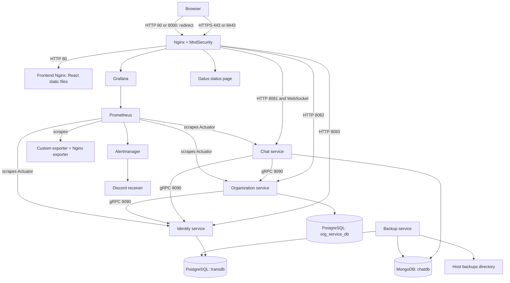
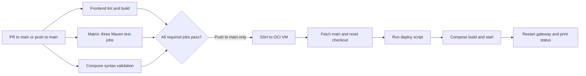

# DevOps implementation and interview study guide

Prepared from the working tree at Git revision `8fae988`, September 25, 2026. This guide describes the code reviewed, not a verified production deployment. No deployments, restore operations, or fault injections were run while preparing it. Private `.env` values were not read.

Start here for the architecture and implementation. Then use [the interview questions](DEVOPS_INTERVIEW.md) to practise explaining decisions, and [the rehearsal and findings checklist](DEVOPS_REHEARSAL.md) to prepare evidence and understand limitations.

The attached project plan describes intended responsibilities. The implementation files determine what you can honestly claim is currently implemented. In particular, a planned Vault module is not evidence of a running secrets manager.

## 1. Your responsibility in one explanation

> I own the infrastructure that builds, connects, exposes, monitors, and recovers our application. I containerized the services, configured the Nginx gateway with HTTPS and ModSecurity, connected the databases and persistent storage, built monitoring with a custom exporter and Prometheus/Grafana, configured alerts and a status page, automated deployment through GitHub Actions and SSH, and implemented database backup and restore scripts. My work also includes understanding the limits of those controls and testing that they work together.

You are responsible for explaining the integration points with your teammates' services. You do not need to claim that you wrote their authentication, room-management, or chat business logic.

For every component, practise five things: the problem it solves, how your configuration solves it, a concrete request/data flow, how you verify it, and what happens when it fails.

## 2. Architecture and request flow



Both PostgreSQL databases are in **one PostgreSQL container**, not independent database servers. All Compose services share one network called `private`. The name does not itself enable special isolation.

### A browser request, end to end

1. DNS resolves `guild-chat.tech` to the VM's public IP. DNS provisioning is outside Compose.
2. Cloud networking and the host firewall must permit the connection.
3. Docker forwards host port 443 to gateway port 8443.
4. Nginx completes TLS, then processes the HTTP request and the applicable WAF/rate-limit rules.
5. A `location` selects the upstream. Some paths have their public prefix removed.
6. Docker service-name resolution directs the connection to the destination container.
7. The service may query its database or another service using gRPC.
8. The response returns through Nginx over the browser's TLS connection.

For the frontend, Nginx returns built HTML, CSS, and JavaScript. React then runs **in the browser** and makes API requests. There is no production Vite development server in this path.

### Ports you should know without looking them up

| Component | Internal listener | Host publication / access |
| --- | --- | --- |
| Gateway | HTTP 8080, HTTPS 8443 | `80:8080`, `8000:8080`, `443:8443`, `8443:8443` |
| Frontend Nginx | 80 | Through gateway |
| Identity | HTTP 8083, gRPC 9090 | Through gateway; gRPC internal |
| Organization | HTTP 8082, gRPC 9090 | Through gateway; gRPC internal |
| Chat | HTTP/WebSocket 8081 | Through gateway |
| PostgreSQL | 5432 | Internal |
| MongoDB | 27017 | Internal |
| Custom exporter | 8090 | Internal; gateway metrics path restricted by IP |
| Nginx exporter | 9113 | Internal |
| Prometheus | 9090 | Internal; gateway path restricted by IP |
| Alertmanager | 9093 | Internal |
| Grafana | 3000 | `/grafana/`, application login |
| Gatus | 8080 | `/status/` and supporting routes, configured basic authentication |
| Backup service | No HTTP listener | Connects to database services |

Identity, organization, and Prometheus can all use port 9090 because each has a separate network namespace/IP address. `localhost` inside a container means that container, not the host or a sibling service.

## 3. Docker and Compose

Primary source: [docker-compose.yml](../docker-compose.yml).

### Images, containers, and build contexts

An image is the packaged filesystem and runtime metadata. A container is a running instance with its own writable layer, processes, networking, and mounts. Containers share the host kernel; they are not full virtual machines. Namespaces isolate views of resources; cgroups account for and can limit resource use.

`build.context` defines the files the builder can access. `COPY` paths are relative to that context, not necessarily the Dockerfile's directory:

- Gateway: context is the repository root, so `COPY ./gateway/...` works.
- Frontend: context is `frontend/app`.
- Identity: context is `services/identity-service`, so the Dockerfile uses `demo/...`.
- Organization: context is `services/org-service`.
- Chat: context is `services`, so its Dockerfile uses `chat-service/...`.

The root `.dockerignore` omits Git, dependency/build directories, and IDE files. It does **not** exclude `.env`, certificates, or backups. The gateway's broad build context should be reviewed to avoid sending unnecessary sensitive data to the builder. A file being in the context does not automatically mean it is copied into the final image.

### Multi-stage builds

The frontend builds with `node:24-alpine`: copy package manifests, run `npm ci`, copy source, run the production build. Its final `nginx:alpine` stage receives only `dist` and the frontend Nginx configuration. Node and the development toolchain are unnecessary at runtime.

The Java services build with Java 21 and Maven. Their Dockerfiles skip tests during image packaging; CI has a separate test job. The builds create a custom runtime with `jlink`, then copy that runtime and the application JAR into Alpine 3.20.

`jlink` includes selected Java modules and strips debug information, manuals, and headers. The benefit is a smaller runtime; the tradeoff is maintaining the module list. A missing module may fail only when a particular runtime feature is exercised. The Alpine builder/runtime choice also matters for native binaries and libc compatibility; `gcompat` is installed in the build stages. Native Protobuf/gRPC tooling and multi-architecture image availability must be tested on the VM's architecture.

Identity and organization copy their POM before source to reuse dependency-download layers when only source changes. Chat copies source before its package step, so it has less separation of dependency resolution from source changes.

Each Java runtime uses user `app`, UID 1000. `COPY --chown` supplies ownership without requiring the application to start as root. Identity additionally prepares its avatar directory. The gateway switches to user `nginx` and listens above 1024 inside its container. Host port publication supplies public 80/443.

Do not generalize this to “every container is non-root.” The frontend uses its upstream Nginx image defaults; the custom exporter and backup image do not set a non-root user.

### Compose keys explained

| Key | Meaning in your project |
| --- | --- |
| `image` | Use a registry image, such as PostgreSQL or Prometheus |
| `build` | Build a local image from a Dockerfile |
| `ports` | Publish container ports on the host; mappings here do not specify a loopback-only address |
| `expose` | Declare internal ports; it does not publish a host port or act as a firewall |
| `networks` | Connect services to the shared Compose network |
| `environment` | Explicit container values, overriding matching `env_file` values |
| `env_file` | Load runtime environment variables into selected containers |
| `volumes` | Persistent data or mounted configuration/files |
| `depends_on` | Define startup dependencies and optional readiness conditions |
| `healthcheck` | Execute a probe inside the container |
| `restart: always` | Restart policy for container exits; not an unhealthy-container repair mechanism |

Compose interpolation such as `${ORG_DATASOURCE_URL}` is evaluated before container creation. By contrast, `$${POSTGRES_USER}` in the PostgreSQL healthcheck escapes the dollar sign through Compose so the container shell expands it.

Many services load the entire shared `.env`. This is convenient but distributes unrelated credentials. Prefer per-service variables and separate database accounts as the system matures.

### Startup and health

PostgreSQL gates identity and organization. MongoDB gates chat. Both databases gate the backup service. The gateway waits for frontend, the three application services, Grafana, and the custom exporter to become healthy; Prometheus and Gatus need only be started.

`service_healthy` makes Compose wait for the configured probe. That is a startup ordering mechanism, not proof that every downstream workflow works. [Docker startup-order reference](https://docs.docker.com/compose/how-tos/startup-order/).

| Probe | What it establishes | What it does not establish |
| --- | --- | --- |
| Gateway `curl -f http://localhost:8080/` | HTTP listener responds without a curl HTTP error | TLS and backend routing; the 301 redirect counts as success |
| Frontend `/` | Nginx serves the entry page | Browser JavaScript or API functionality |
| Identity `/actuator/health/readiness` | Spring readiness endpoint passes | A complete login/profile workflow or all dependencies unless included in the group |
| Organization `/healthz` | Controller responds `OK` | Database connectivity; this controller just returns a string |
| Chat `/actuator/health` | Configured Actuator health checks pass | Full cross-service authorization and WebSocket delivery |
| PostgreSQL `pg_isready` | Server is accepting connections | Correct application credentials, schema, and useful queries |
| MongoDB ping | Server responds to ping | Authenticated chat read/write access |
| Exporter `/metrics.prom` | Metrics file is reachable | Every collection source works or the file is fresh |
| Grafana `/api/health` | Grafana health endpoint succeeds | Correct dashboard queries or all scrape targets |

An unhealthy container can remain running indefinitely. `restart: always` reacts to process/container exit, not the health label alone. `start_period` gives initialization a grace period; `interval`, `timeout`, and `retries` govern probe scheduling and failure classification.

A notable coupling: a broken Grafana or exporter healthcheck can prevent the gateway from starting, even when the application services work. Discuss separating monitoring availability from application ingress availability.

### Persistence

| Storage | Mounted at | Purpose |
| --- | --- | --- |
| `database` | PostgreSQL `/var/lib/postgresql/data` | Both PostgreSQL databases |
| `mongo_data` | MongoDB `/data/db` | MongoDB data |
| `identity_avatars` | Identity `/tmp/identity-avatars` | Uploaded files; persistent despite the `/tmp` path |
| `prometheus_data` | `/prometheus` | Time-series database |
| `grafana_data` | `/var/lib/grafana` | Grafana state |
| `./backups` bind mount | Backup container `/backups` | Dump archives on the host |
| `./certs` bind mount | Gateway `/certs`, read-only | Host-supplied TLS material |

Named volumes survive container recreation and ordinary `docker compose down`. They are not backups: accidental deletion, corruption, and host loss remain possible. Explicit global volume names and fixed container/network names also make multiple copies of this project on one Docker daemon collide.

PostgreSQL's init SQL creates `org_service_db`. Initialization scripts run when the database data directory is first initialized; editing the SQL later does not migrate an existing volume. Likewise, changing initialization passwords in `.env` does not automatically rotate credentials in an existing database.

## 4. Gateway, routing, HTTPS, and WAF

Sources: [gateway/nginx.conf](../gateway/nginx.conf), [Dockerfile](../gateway/Dockerfile), [startup script](../gateway/script.sh), [ModSecurity overrides](../gateway/modsec/modsecurity-override.conf).

### Why two Nginx containers?

The gateway centralizes TLS, public routing, and ingress controls. The frontend Nginx serves a built SPA. Separating them lets the frontend image contain its own static assets while the gateway remains responsible for service routing.

Frontend `try_files $uri $uri/ /index.html` first tries a real file/directory, then returns the SPA entry page so React can handle client-side routes after a refresh. Compression is enabled for selected text formats.

### Route map

| Browser path | Destination | Rewrite / special handling |
| --- | --- | --- |
| `/api/users/...` | Identity | Remove `/api/users/` |
| `/api/auth/...` | Identity | Remove `/api/auth/` |
| `/api/orgs/...` | Organization | Remove `/api/orgs/` |
| `/api/chat/...` | Chat | Remove `/api/chat/` |
| `/api/rooms` and `/api/rooms/...` | Chat | Preserve path; confirm endpoint contract when debugging |
| `/ws/chat` | Chat | HTTP/1.1 upgrade, long read timeout |
| `/grafana/...` | Grafana | Strip prefix; Grafana root URL contains `/grafana/` |
| `/prometheus/...` | Prometheus | Strip prefix; IP restrictions |
| `/metrics.prom` | Custom exporter | IP restrictions |
| `/status` | Redirect | Redirect to `/status/` |
| `/status/...` | Gatus | Strip prefix |
| `/api/v1/...`, selected assets | Gatus | Support status UI |
| `/` and remaining paths | Frontend | SPA/static assets |

Example: `/api/users/login` is proxied as `/login`. `rewrite ... break` changes the URI within the selected location; the resulting path must match the backend controller. A routing problem can be a wrong rewrite even when both containers are healthy.

Nginx forwards Host and client/protocol headers at server level. **Locations that define their own `proxy_set_header` directives do not inherit the parent set.** Your WebSocket, Grafana, and some status locations therefore need individual review if upstreams depend on `X-Forwarded-Proto` or client IPs. [Nginx header inheritance](https://nginx.org/en/docs/http/ngx_http_proxy_module.html).

Gatus asset handling includes a `sub_filter` replacement of a specific minified JavaScript string. It is a compatibility workaround, fragile across upstream UI changes. Disabling upstream compression there makes text replacement possible. Those global `/css/`, `/js/`, and `/api/v1/` routes also reserve paths that future application features could otherwise use.

### TLS startup sequence

1. Look for readable mounted `fullchain.pem` and `privkey.pem`.
2. Otherwise look for readable custom `server.crt` and `server.key`.
3. Copy the chosen files into Nginx's configuration directory.
4. If no certificate exists there, generate a self-signed RSA-2048 certificate valid for 365 days, with SANs for the configured domain, localhost, and loopback.
5. Execute the base image entrypoint, which performs its startup processing, then starts Nginx in the foreground.

`exec` replaces the script process so the actual entrypoint/server receives container signals appropriately. `daemon off;` keeps Nginx in the foreground rather than letting the container's main process finish.

The gateway accepts TLS 1.2/1.3 and redirects ordinary HTTP to `https://$host$request_uri`. An HTTP request to port 8000 redirects to standard HTTPS 443, not necessarily 8443.

A self-signed certificate can encrypt traffic but does not supply browser-trusted identity. A trusted certificate requires correct domain resolution, certificate issuance, expiry management, and private-key protection. Public certificate and private key are different: the certificate can be shared; the key must remain restricted.

The deployment guide copies Let's Encrypt files into `certs`. Renewal of the originals does not refresh those copies. No automated renewal/copy/reload hook is implemented here. Because the startup script copies mounted certificates again on startup, simply reloading Nginx without refreshing its copied files is insufficient.

TLS terminates at the gateway. Backend HTTP and the reviewed gRPC channels are plaintext on the Docker network. Do not claim end-to-end TLS or mutual TLS between services.

### WebSockets

The browser begins with an HTTP handshake and requests an upgrade. On success, the backend returns `101 Switching Protocols`, and the connection becomes persistent and bidirectional. Nginx explicitly forwards `Upgrade` and `Connection` headers and uses HTTP/1.1 for the upstream hop. `proxy_read_timeout 3600s` permits a longer interval between upstream reads; it is not a fixed maximum session lifetime. [Nginx WebSocket reference](https://nginx.org/en/docs/http/websocket.html).

Debug handshake status first, then authentication, subscription/membership checks, and finally message delivery. A working REST request does not prove WebSocket forwarding works.

### WAF and rate limiting

The gateway uses the OWASP ModSecurity CRS Nginx image, loads the ModSecurity module, and references its generated setup configuration. CRS provides general attack-detection rules; ModSecurity is the processing engine.

Compose explicitly configures blocking mode and paranoia level 1, and the override file says `SecRuleEngine On`. `.env.example` contains `DetectionOnly`, but the gateway does not consume that example value as its effective engine setting. Read the rendered/runtime configuration when verifying enforcement.

- Request-body inspection is enabled; response-body inspection is disabled.
- The allowed HTTP methods include PUT, PATCH, and DELETE so legitimate editing/deletion operations can pass method policy.
- WebSocket URIs are excluded by a ModSecurity override.
- Monitoring/status locations have WAF bypasses in Nginx and/or the overrides.
- A WAF does not implement room membership authorization, fix application SQL construction, or inspect ongoing WebSocket messages after the handshake as normal HTTP requests.

The API limiter uses a 10 MB shared zone keyed by client IP, a sustained rate of 20 requests/second, and `burst=30 nodelay`. Bursts within the allowed budget are admitted immediately; excess requests return 429. This is a shared IP-based budget across the participating locations, not a separate quota per user. Users behind the same NAT can affect each other. The WebSocket connection/message flow is not governed by those REST location limits.

IP restrictions on metrics and Prometheus allow loopback and broad RFC1918 private ranges. They are a network-origin policy, not user authentication; verify the source address Nginx actually sees after Docker/NAT or other proxies.

## 5. Configuration, secrets, and least privilege

`.env.example` is a template. `.env` is ignored by Git and loaded at deployment. GitHub Actions secrets supply the SSH connection parameters. This is environment-based secret delivery, not a Vault integration.

`infra/vault/config.hcl` is empty and Compose has no Vault service. Do not claim Vault is implemented. Similarly, Grafana provisioning removes a Loki datasource and Compose has no Loki deployment; current monitoring is not a centralized Loki logging stack.

Know the distinction between authentication (who are you?), authorization (what may you do?), encryption (confidentiality in transit/at rest), and WAF filtering (reject suspicious request patterns). These are complementary controls.

Areas to understand before the interview:

- Shared environment files spread credentials; dedicated DB accounts should have only necessary permissions.
- Docker group membership and daemon socket access are powerful privileges. The exporter reads the daemon API through a mounted socket; `:ro` on the socket mount does not make API operations read-only. A filtering socket proxy/authorization boundary would be stronger. [Docker daemon security](https://docs.docker.com/engine/security/).
- The repository contains a Discord webhook credential in the Alertmanager file. Treat it as exposed; rotate it and remove it from tracked configuration. Do not copy its value into slides or interview notes.
- Backup permissions are deliberately widened by the current script (`777` directory, `666` files). This exposes database dumps to other local users and requires improvement.
- The existing certificate instructions suggest `chmod 644` for keys. Prefer ownership/group access that lets the gateway read the key without making it world-readable.
- The network is shared and is not configured with `internal: true`. It does not provide per-service segmentation or encryption.

## 6. Observability: collection, storage, display, and alerting

Sources: [Prometheus configuration](prometheus/prometheus.yml), [alert rules](prometheus/alert_rules.yml), [exporter script](docker-exporter/script.sh), [Grafana provisioning](grafana/datasources/prometheus.yml), [Gatus configuration](status/config.yaml).

### Responsibilities

| Component | Responsibility |
| --- | --- |
| Spring Actuator + Micrometer | Expose application/JVM metric samples |
| Custom exporter | Convert Docker API, Linux files, PostgreSQL queries, and optional Nginx status into metrics |
| Nginx exporter | Convert gateway `stub_status` into Prometheus metrics |
| Prometheus | Periodically scrape samples, store time series, evaluate queries and alert rules |
| Grafana | Query Prometheus and render provisioned dashboards |
| Alertmanager | Group and route firing/resolved alerts to Discord |
| Gatus | Independently probe internal endpoints and display availability history in memory |

Metrics are numeric time series, logs are event records, and traces show a request's path/timing across services. This stack does not implement distributed tracing.

### Prometheus data flow

Global scrape and evaluation intervals are 15 seconds. Application services override scraping to 10 seconds at `/actuator/prometheus`. Other targets are Prometheus itself, the custom exporter at `/metrics.prom`, and `nginx-exporter:9113`.

The scraper calls internal service addresses directly; it does not need to go through the public gateway. Prometheus adds labels such as `job` and `instance`. A metric name plus its complete label set identifies a time series. Avoid high-cardinality values such as arbitrary user IDs or message text as labels.

`up=1` means the scrape succeeded, not that all application behavior is correct. Application health, container health, and scrape health answer different questions.

### Custom exporter, step by step

1. Prepare a temporary web directory and logging settings.
2. Run a background collection loop.
3. Read Linux `/proc` and optional `/sys` information.
4. Attempt to collect Nginx `stub_status`.
5. Query PostgreSQL statistics using `psql` and `PG*` environment variables.
6. List running containers through the Docker Unix socket.
7. For each container, read `/stats?stream=false` and its inspect JSON.
8. Convert values into Prometheus text samples using shell tools, `awk`, and `jq`.
9. Copy the completed data to a hidden file in the served directory, then rename it to `metrics.prom`.
10. Sleep five seconds, then repeat. Separately, BusyBox HTTPD serves the file on port 8090.

The rename makes readers see a complete old or new file instead of a half-written collection. Collection time is added to the five-second sleep, so the real sample period is **not exactly five seconds**. Sequential Docker calls or an unbounded database request can delay it. The HTTP server may continue serving old data if the collector fails; a timestamp/collection-success metric is a useful improvement.

The script logs to stderr and to a file, rotating the file above approximately 5 MB. `LOG_LEVEL` controls verbosity. The container's `/tmp` log file is not persisted.

### Exported metric families

| Source | Examples | Interpretation |
| --- | --- | --- |
| Docker memory | `container_memory_usage_bytes`, `container_memory_limit_bytes` | Current consumption and daemon-reported limit |
| Docker CPU | `container_cpu_usage_total_nanoseconds`, `container_cpu_system_usage_nanoseconds` | Cumulative CPU time; use deltas/rates |
| Docker network | Receive/transmit byte totals | Throughput requires a rate |
| Docker block I/O | `container_blkio_io_service_bytes_total` | Aggregated cumulative I/O bytes |
| Docker lifecycle | Running, restart count, OOM flag, start time | Container state evidence, with collection limitations |
| Linux CPU | Per-core and total percentage; load averages | CPU utilization and scheduler load are different concepts |
| Linux memory | Total, available, cached, buffers | Available memory is more useful than simply treating cache as unavailable |
| Linux hardware | Optional power/temperature | Hardware/permission dependent; Intel paths may be absent on ARM/cloud VMs |
| Linux network/disk | Byte counters and space gauges | Scope depends on the container's namespaces and visible mounts |
| PostgreSQL | Connections, DB size, commits, rollbacks, deadlocks, temp files | Workload and pressure indicators |
| PostgreSQL tables | Dead tuples, vacuum age | Collected for the connected database; not automatically every database |
| PostgreSQL replication/locks | Replica lag if rows exist; granted/waiting locks | A replication query does not mean replicas are configured |

The exporter runs inside a container without dedicated host filesystem/namespace mounts. Do not describe all `node_*` values as verified full-host monitoring: `/proc/net/dev` reflects its network namespace, and host filesystems/sensors may be absent. The disk code also treats field 6 of `/proc/mounts` as a mountpoint although the mountpoint is field 2, and uses GNU `df --output` despite an Alpine toolchain. These are concrete reasons to inspect whether disk metrics are emitted.

Its default Nginx URL omits `:8080`, so the custom Nginx collection needs a correct `NGINX_STATUS_URL`. The separate Nginx exporter is configured with the correct port.

### Reading PromQL rather than memorizing dashboards

```promql
# Request throughput by service: requests per second.
sum by (job) (rate(http_server_requests_seconds_count[5m]))

# CPU usage as a percentage of ONE CPU core.
rate(container_cpu_usage_total_nanoseconds[5m]) / 1e9 * 100

# Memory usage divided by the reported memory limit.
100 * container_memory_usage_bytes / container_memory_limit_bytes

# Incoming network bytes per second.
rate(container_network_receive_bytes_total[5m])
```

A gauge can increase or decrease; a counter accumulates until it resets. `rate()` estimates per-second change of a counter and handles resets. Use a time window with enough samples. [Prometheus functions](https://prometheus.io/docs/prometheus/latest/querying/functions/).

CPU percentages need a denominator. The microservices dashboard expresses consumption relative to one core and can exceed 100% on multiple cores. The Docker dashboard divides container CPU-time rate by system CPU-time rate, expressing a different share. Do not compare these as if they used the same normalization.

The dashboard's memory denominator comes from Docker. Compose does not set explicit service memory limits, so “85% of limit” is not necessarily 85% of an intentionally assigned application budget. JVM heap is only part of process/container memory: native memory, thread stacks, and other allocations matter too.

### Grafana

The datasource has UID `prometheus` and points to `http://prometheus:9090`; matching UIDs let dashboard queries bind reliably. A file provider scans the provisioned dashboard directory every 10 seconds. Git-managed configuration helps reproduce the display after recreation. [Grafana provisioning](https://grafana.com/docs/grafana/latest/administration/provisioning/).

The microservices dashboard shows scrape status, request throughput, 5xx throughput, JVM heap, and CPU. The Docker dashboard includes memory, network throughput, CPU, uptime, restarts, and block I/O. Its JSON is a resource-style document, while the other dashboard uses a classic model: verify both load in the deployed Grafana version.

The Grafana Dockerfile attempts to remove unused datasource plugins in a builder stage, then copies its directory into a fresh instance of the same base image. Copying a reduced directory does not delete destination files already present in the final base. Do not claim that this proves plugin removal or image-size savings; inspect the resulting filesystem and image size.

### Alerts

| Alert | Actual configured condition | Caveat |
| --- | --- | --- |
| `MicroserviceDown` | Application scrape `up == 0` for 30 seconds | Detects metric endpoint reachability, not every user-facing failure |
| `ContainerDown` | Recently running series absent/not running, with a five-minute lookback and 30-second hold | Can be confused by exporter failure or label changes; old absence eventually leaves lookback |
| `ContainerOOMKilled` | OOM flag equals 1 | Exporter lists only running containers, potentially missing a stopped OOM victim |
| `HighContainerCpuUsage` | `container_cpu_usage_percentage > 85` for two minutes | That metric is not emitted and no recording rule defines it |
| `HighContainerMemoryUsage` | Usage/limit above 85% for two minutes | Interpret limit and missing/zero values correctly |
| `HighHttp5xxErrorRate` | Per-series 5xx counter rate above 0.05 for one minute | This is errors/second, despite the description saying 5% |

Prometheus evaluates conditions and sends firing alerts to Alertmanager. A `for` clause requires the condition to remain active across evaluations. [Prometheus alert-rule reference](https://github.com/prometheus/prometheus/blob/main/docs/configuration/alerting_rules.md).

Alertmanager groups by alert name and container, waits 10 seconds initially, uses a 10-second group interval, repeats after one hour, and sends resolved notifications. Notifications also need working outbound networking and a valid receiver. End-to-end delivery has not been verified by this documentation review.

To express a true per-service 5xx percentage, divide the summed 5xx rate by the summed total request rate and compare the ratio with `0.05`; define missing-series and zero-traffic behavior deliberately. To express CPU percentage, derive it from emitted cumulative CPU time and state the core normalization. These are proposed corrections, not changes applied here.

### Gatus and logs

Gatus probes every 10 seconds. Identity and organization check HTTP status and JSON `status == UP`; chat checks HTTP status. Database checks are TCP connectivity checks. In-memory storage means status history is lost on restart. Internal probes do not verify public DNS, public certificate trust, or the full login/chat flow.

Docker captures stdout/stderr. The VM setup configures the `json-file` log driver with 20 MB files and three retained files. This limits local log growth; it does not create centralized searchable logging. Review daemon changes carefully: the setup script overwrites `/etc/docker/daemon.json` and restarts Docker.

## 7. CI/CD: explain your workflow line by line

Source: [.github/workflows/ci-cd.yml](../.github/workflows/ci-cd.yml).



### Triggers and jobs

Pull requests targeting `main` run validation. Pushes to `main` run validation and can deploy. The `needs` list makes deployment depend on all validation jobs; the deployment `if` condition excludes pull-request events.

Frontend: checkout, Node 22 setup, npm cache keyed through the lockfile, `npm ci`, ESLint, production build. `npm ci` installs the lockfile's dependency graph and fails when manifests and lockfile disagree. Caching downloads speeds builds; it does not replace installation or testing. The Docker frontend build uses Node 24, so CI and production build environments currently differ.

Backend: a matrix runs chat, identity, and organization tests in their own directories on Java 21. `fail-fast: false` allows other matrix jobs to finish if one fails, yielding more diagnostic information. Maven dependency caching avoids repeat downloads. The identity test profile and organization test configuration use H2 in PostgreSQL compatibility mode; that is not identical to PostgreSQL. Chat's test support starts an authenticated MongoDB 7 Testcontainers container and registers its dynamic connection settings.

Compose validation: copy `.env.example` to `.env`, then run `docker compose config -q`. This validates the Compose model/interpolation; it does not build images, start services, test routes, verify secrets, or check production data.

### SSH and VM deployment

GitHub secrets provide `OCI_HOST`, `OCI_USERNAME`, `OCI_SSH_KEY`, and optional `OCI_SSH_PORT` (default 22). `appleboy/ssh-action@v1.2.0` opens the remote session. The key authenticates the deployment client; host-key/fingerprint verification is a separate concern and is not explicitly configured in this workflow.

On the VM the workflow:

1. Checks that `~/ft_transcendence` exists.
2. Changes to that checkout.
3. Fetches `origin main` and resets tracked files to `origin/main`.
4. Runs `bash deploy/deploy.sh`.

`git reset --hard` discards tracked local modifications on the VM. Keep runtime configuration out of tracked files. Both deployment scripts **are tracked** at the reviewed revision, even though the broad `*.sh` ignore pattern would affect newly added unmatched scripts; ignore rules do not untrack existing files.

The deployment script enables `set -eo pipefail`, moves to the project root, pulls `main` again, checks `.env`, detects a Docker socket path, runs `docker compose up -d --build --remove-orphans`, restarts the gateway, prunes dangling images, waits five seconds, and prints Compose status.

`-e` stops on many unhandled command failures; it is not universal exception handling. `pipefail` propagates pipeline failures that would otherwise be hidden by a successful final command. `docker image prune -f` removes dangling images; it does not remove named database volumes.

The socket-path selection controls the bind mount used by the exporter. It does not itself select a different Docker CLI context/daemon. Check both if using rootless Docker.

Restarting the gateway also reruns certificate selection and refreshes static upstream resolution after backend recreation. It interrupts active connections; this is not zero-downtime deployment.

### What this pipeline does not guarantee

- It builds on the VM; it does not publish a tested immutable image to a registry and promote its digest.
- It fetches the latest `main`, not necessarily the triggering commit SHA. Another push can advance the branch before deployment.
- There is no deployment concurrency lock, automatic rollback, or explicit post-deploy application smoke-test gate.
- Printing `docker compose ps` is not an assertion that all services are healthy.
- CI does not run the whole Compose stack, perform container image builds, or test the complete HTTPS/WebSocket flow.
- Java tests are separate from the `-DskipTests` image build, and frontend Node versions differ.
- Floating image tags and tagged actions can change; reproducibility would improve through version/digest pinning and controlled updates.

Strong next steps: deploy the tested SHA/artifact, serialize production deployment, wait for readiness, run smoke tests, and keep a known-good artifact with a database-compatible rollback plan.

## 8. VM provisioning and operational commands

Sources: [setup script](../deploy/setup-vm.sh), [deployment script](../deploy/deploy.sh), [Makefile](../Makefile).

The bootstrap script requires root, identifies the intended sudo user, installs prerequisites and Certbot, installs Docker if absent, grants Docker group membership, configures log rotation, restarts Docker, opens configured TCP ports through iptables, persists firewall rules, and prepares the certificate directory.

Understand both networking layers: OCI security lists/NSGs and the VM/Docker firewall behavior. An Nginx listener alone is insufficient if cloud ingress blocks it. Conversely, rules limited to the host INPUT chain are not the full story for Docker-published ports; inspect Docker's forwarding rules before claiming complete filtering.

The repository deployment README suggests ARM-based OCI infrastructure. Verify the actual VM architecture, resources, image support, and current account limits independently; this guide does not certify cloud pricing or free-tier availability.

| Make target | Actual purpose / caution |
| --- | --- |
| `make up` | Check environment, start existing/build-needed services detached |
| `make build` | Start with image rebuilding |
| `make down` | Stop/remove stack containers and network, retain named data volumes |
| `make clean` | Down plus orphan removal; preserves named volumes |
| `make re` | Clean then build; interruption expected |
| `make logs` / `make ps` | Inspect output/status |
| `make backup` | Run manual database dump script |
| `make restore SNAPSHOT=...` | Restore a selected dump pair; overwrites data |
| `make test-recovery` | Mutate data and run a database restore; use disposable environment |
| `make fclean` | Delete project volumes and run daemon-wide unused-image/cache pruning; destructive |
| `make monitoring`, `microservices`, `proxy` | Contain `down -v --remove-orphans`; review exact Compose behavior before use |

The missing-`.env` branch in the `run` recipe uses `@echo` and `@exit` inside a shell conditional. `@` is a Make recipe prefix, not a shell builtin prefix, so that error path needs correction. `make status` currently runs two requests and uses `curl -k`; a successful response there does not verify certificate trust.

## 9. Backup and recovery

Sources: [automated backup](backup/backup.sh), [manual backup](../scripts/backup.sh), [restore](../scripts/restore.sh), [recovery demonstration](../scripts/test-disaster-recovery.sh).

### Automated backup flow

The Alpine backup image includes PostgreSQL 16 client tools, MongoDB tools, gzip, Bash, and timezone data. It connects over the Compose network, without needing the Docker socket.

It creates `/backups`, waits for PostgreSQL to accept connections, dumps `POSTGRES_DB` using `pg_dump --clean --if-exists --format=p`, compresses the SQL, and copies it to a `latest` filename. It then attempts a MongoDB archive dump with gzip and updates its latest copy on success. Timestamped old files are pruned using `find -mtime +RETENTION_DAYS`; latest copies are excluded.

Defaults are 43,200 seconds (12 hours) between completed iterations and retention setting 7 days. `find -mtime` uses whole-day age semantics; do not promise deletion at exactly 168 hours. The current code performs a backup **immediately on startup**. Despite older commit descriptions, no five-minute startup delay exists in this reviewed file.

The `latest` files are ordinary copies, not symlinks. PostgreSQL latest is updated before MongoDB is attempted, so a MongoDB failure can leave the latest pair from different times. Concurrent manual and automated runs have no lock or atomic pair publication.

### Coverage and consistency

`pg_dump` covers one specified database, not every database in the PostgreSQL server. Here the default is `transdb`, while organization data lives in `org_service_db`; the latter is not dumped by these scripts. [PostgreSQL logical-dump reference](https://www.postgresql.org/docs/18/backup-dump.html).

The MongoDB commands omit a `--db` restriction, so they request an all-accessible-databases dump, despite log messages mentioning chatdb. Scope and authorization should be verified with the actual account.

The backup set does not cover avatar files, PostgreSQL global roles, TLS keys, runtime configuration, Grafana/Prometheus state, or the host. Files stay on the same host; host loss can destroy both data and backups. Independent sequential database dumps also do not guarantee a consistent cross-service business transaction snapshot.

This is logical snapshot recovery, **not PostgreSQL point-in-time recovery**. PITR would require an appropriate base backup and WAL archiving/replay. Choosing a timestamped dump only chooses one completed snapshot.

RPO is acceptable data loss measured in time; RTO is acceptable recovery duration. A 12-hour schedule gives a rough normal-operation data-age target near that interval plus backup time, not a guaranteed maximum loss. Failed backups can make it older, and recovery time must be measured through a real restore drill.

### Manual backup and restore

The manual script reads selected variables from `.env` with a simple parser, then uses `docker exec` and the database containers' client tools. PostgreSQL connects over its local Unix socket; this uses local authentication rules rather than the network path. The parser is not a complete dotenv implementation. MongoDB credentials are assembled into an unquoted argument string, so whitespace/special-value handling deserves review.

Restore chooses timestamped files or latest copies, checks the PostgreSQL file, attempts to terminate PostgreSQL sessions for the target DB, streams decompressed SQL into `psql`, and restores MongoDB with `--drop`. It lists tables/collections afterward.

Important limits:

- Applications are not stopped/quiesced and may reconnect or write during restore.
- `psql` lacks `ON_ERROR_STOP=1`, so SQL statement errors can coexist with an apparently successful shell command.
- `mongorestore` has `|| true` and output suppression, then prints success even if the command failed.
- A missing MongoDB archive is skipped; completion does not imply both databases were restored.
- `--clean` SQL and MongoDB `--drop` replace restored objects; this is destructive to newer data.
- There is no preflight checksum, full backup-set manifest, or restore transaction spanning databases.

The recovery demonstration inserts a PostgreSQL test record and a MongoDB message, makes a snapshot, deletes those records, restores, verifies marker recovery, and cleans up. It demonstrates recovery of those markers if it passes. It does not prove full-system recovery, organization/avatars coverage, or a host-loss scenario. Its restore affects real database contents; rehearse only on a disposable copy.

## 10. Source map for revision

| Topic | Files to open and explain |
| --- | --- |
| Stack topology | `docker-compose.yml`, `.env.example` |
| Daily commands | `Makefile` |
| CI jobs / deployment gate | `.github/workflows/ci-cd.yml` |
| VM preparation / deployment | `deploy/setup-vm.sh`, `deploy/deploy.sh` |
| Ingress and certificate lifecycle | `gateway/Dockerfile`, `gateway/script.sh`, `gateway/nginx.conf` |
| WAF exclusions | `gateway/modsec/modsecurity-override.conf` |
| Runtime image construction | Frontend and three service Dockerfiles |
| Application health/metrics integration | Service application properties/YAML and Maven dependencies |
| PostgreSQL initialization | `infra/postgres/init/01-create-org-service-db.sql` |
| Collection | `infra/docker-exporter/script.sh`, its Dockerfile |
| Metrics and alerts | `infra/prometheus/prometheus.yml`, `alert_rules.yml`, `alertmanager.yml` |
| Visualization | Grafana datasource/provider YAML, both dashboard JSON files |
| Availability page | `infra/status/config.yaml` |
| Backup/restore | `infra/backup/backup.sh`, `scripts/*.sh` |

Use the companion [interview questions](DEVOPS_INTERVIEW.md) to test whether you can explain these files without reading them aloud.
