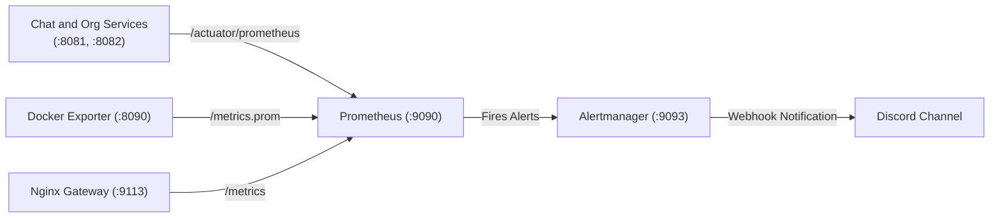

# Prometheus & Alertmanager Monitoring Stack

This directory contains the central metric aggregation and alerting configurations for `ft_transcendence`.

---

## Architecture Overview

Prometheus scrapes metrics every 10–15 seconds from backend microservices, the custom Docker dashboard exporter, and API gateway. When conditions breach predefined operational thresholds, Alertmanager dispatches real-time webhooks to Discord.



---

## Scrape Configurations (`prometheus.yml`)

Prometheus operates inside the private container network and scrapes the following targets:

| Job Name | Target URI | Interval | Description |
| :--- | :--- | :--- | :--- |
| `prometheus` | `localhost:9090` | 15s | Internal Prometheus performance metrics |
| `docker-exporter` | `docker-exporter:8090/metrics.prom` | 15s | Docker container metrics and system uptime |
| `chat-service`    | `chat-service:8081/actuator/prometheus` | 10s | Chat microservice JVM and socket metrics |
| `org-service`     | `org-service:8082/actuator/prometheus` | 10s | Organization service JVM and database metrics |
| `nginx-gateway`   | `nginx-exporter:9113` | 15s | Nginx connection status and request throughput |

Identity uses Fastify. Docker and Gatus monitor `identity-service:8083/health`;
its Prometheus metrics endpoint and related alerts will be agreed separately.
Identity container resource metrics remain available through docker-exporter.

---

## Alert Rules (`alert_rules.yml`)

| Alert Name | Condition Expression | Duration | Severity | Action / Meaning |
| :--- | :--- | :--- | :--- | :--- |
| `MicroserviceDown` | `up == 0` for core services | 30s | `critical` | Core Spring Boot microservice has stopped responding |
| `HighContainerCpuUsage` | `Container CPU rate / system CPU rate × 100 > 85` | 2m | `warning` | Container using >85% of total host CPU capacity |
| `HighContainerMemoryUsage` | Memory usage > 85% of limit | 2m | `warning` | Container nearing memory threshold |
| `HighHttp5xxErrorRate` | Sum of 5xx rates / sum of all request rates, grouped by job, > 5% over 5m | 1m | `critical` | Service throwing unexpected server errors |
| `DockerExporterUnhealthy` | Scrape down, collection failed, or last success older than 60s | 1m | `warning` | Container measurements unavailable |

---

## Alertmanager Notification Pipeline (`alertmanager.yml`)

- **Routing:** Deduplicates alerts grouped by `alertname` and `container`.
- **Receiver:** `discord-native` webhook integration.
- **Repeat Interval:** 1 hour for unresolved alerts.
- **Auto-Resolve:** Sends a green `RESOLVED` follow-up message when the metric returns to normal.

## Discord configuration

Delete the exposed webhook in Discord, create a replacement, and set
`DISCORD_WEBHOOK_URL=https://discord.com/api/webhooks/.../...` in the existing
ignored `.env` file. Do not put the replacement in `alertmanager.yml`.

Compose passes this variable to Alertmanager. `start-alertmanager.sh` validates
it, renders the tracked template into `/tmp/alertmanager.yml` inside the container,
and starts Alertmanager. No separate secret file is required. Empty or invalid
values stop Alertmanager with a clear error. The generated config is readable only
by the container user. Use the webhook URL without query parameters.

After changing `.env`, recreate Alertmanager so it receives the new value:

```bash
docker compose up -d --force-recreate alertmanager
```

## Memory limits

Compose sets these starting budgets, based on local idle measurements with
headroom. Check startup and representative traffic before deploying them on a
busier host; adjust `mem_limit` in `docker-compose.yml` if necessary. A container
can be OOM-killed at its limit, and JVM heap/database caches must fit inside it.

| Containers | Limit per container |
| --- | --- |
| chat-service, org-service, mongodb | 1 GiB |
| identity-service, postgres, prometheus, grafana, backup-service | 512 MiB |
| nginx | 256 MiB |
| alertmanager, status-page | 128 MiB |
| frontend, docker-exporter, docker-socket-proxy, nginx-exporter | 64 MiB |

The memory alert excludes zero limits. The CPU percentage measures share of the
whole host, matching Grafana: one busy core on a four-core host is about 25%.
HTTP error alerts currently cover the Spring services, not Fastify identity.

## Validation and rollout

```bash
bash scripts/test-monitoring.sh
# After configuring the replacement webhook and reviewing the memory budgets:
docker compose up -d --build
```

The checks use a fake webhook and disabled container networking for Alertmanager;
they do not send notifications. They cover HTTP ratios (busy, quiet, idle and
multiple endpoints), CPU normalization, zero memory limits, and exporter health.
For an end-to-end notification check, trigger a controlled alert and confirm both
the firing and resolved messages in Discord.
