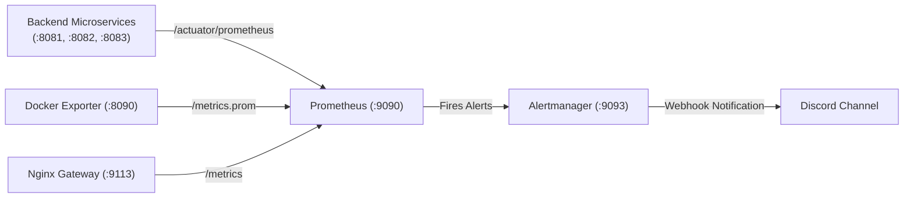

# Prometheus & Alertmanager Monitoring Stack

This directory contains the central metric aggregation and alerting configurations for `ft_transcendence`.

---

## Architecture Overview

Prometheus scrapes metrics every 10–15 seconds from backend microservices, the custom host/container exporter, and API gateway. When conditions breach predefined operational thresholds, Alertmanager dispatches real-time webhooks to Discord.

---

## Scrape Configurations (`prometheus.yml`)

Prometheus operates inside the private container network and scrapes the following targets:

| Job Name | Target URI | Interval | Description |
| :--- | :--- | :--- | :--- |
| `prometheus` | `localhost:9090` | 15s | Internal Prometheus performance metrics |
| `docker-exporter` | `docker-exporter:8090/metrics.prom` | 15s | Host hardware, Docker container, and PostgreSQL metrics |
| `identity-service`| `identity-service:8083/actuator/prometheus` | 10s | JVM, GC, memory, and HTTP request metrics |
| `chat-service`    | `chat-service:8081/actuator/prometheus` | 10s | Chat microservice JVM and socket metrics |
| `org-service`     | `org-service:8082/actuator/prometheus` | 10s | Organization service JVM and database metrics |
| `nginx-gateway`   | `nginx-exporter:9113` | 15s | Nginx connection status and request throughput |

---

## Alert Rules (`alert_rules.yml`)

| Alert Name | Condition Expression | Duration | Severity | Action / Meaning |
| :--- | :--- | :--- | :--- | :--- |
| `MicroserviceDown` | `up == 0` for core services | 30s | `critical` | Core Spring Boot microservice has stopped responding |
| `ContainerDown` | Historical container heartbeat missing | 30s | `critical` | Docker container stopped or crashed |
| `ContainerOOMKilled` | `container_oom_killed == 1` | 0m | `critical` | Container killed by Linux kernel due to memory limit |
| `HighContainerCpuUsage` | `container_cpu_usage_percentage > 85%` | 2m | `warning` | Container CPU sustained above 85% |
| `HighContainerMemoryUsage` | Memory usage > 85% of limit | 2m | `warning` | Container nearing memory threshold |
| `HighHttp5xxErrorRate` | 5xx error rate > 5% over 5m | 1m | `critical` | Service throwing unexpected server errors |

---

## Alertmanager Notification Pipeline (`alertmanager.yml`)

- **Routing:** Deduplicates alerts grouped by `alertname` and `container`.
- **Receiver:** `discord-native` webhook integration.
- **Repeat Interval:** 1 hour for unresolved alerts.
- **Auto-Resolve:** Sends a green `RESOLVED` follow-up message when the metric returns to normal.
